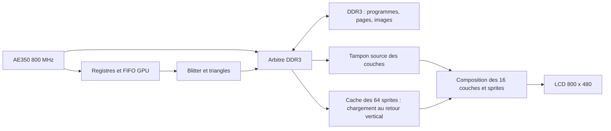

# Console de jeux Pro Dock — architecture V2

Révision du 27 septembre 2026, suite à la correction de Michael.
Ce document remplace le périmètre et le plan de `ARCHI_V1.md`.

## 1. Décisions de Michael

- Produit : **console de jeux** avec carte graphique évoluée et nombreuses
  accélérations matérielles.
- Carte : Tang Mega 138K **Pro Dock FPG676**, AE350 à **800 MHz**.
- Écran : LCD **800 × 480**, déjà validé avec la mire.
- Mémoire externe : **DDR3 uniquement**, partagée entre CPU et graphique.
- **16 couches graphiques superposables**, confirmé explicitement. Une couche
  est un élément de la composition affichée ; une page est une image stockée.
  Les pages et les couches ont des identifiants et des fonctions distincts.
- Sprites et texte, avec une première 3D si les ressources et performances le
  permettent.
- Entrées : boutons/interrupteurs, ADS1115, éventuellement manettes de jeu.
  Sorties : LED et périphériques simples.
- Le langage maison et le chargement par USB CDC restent prévus.

Le sampler 16 voies à 100 MHz, les captures rapides, le déclenchement,
les anneaux d'acquisition et les vues d'oscilloscope sont retirés du périmètre.
Les blocs hérités de l'analyseur encore présents dans le socle E2 ne définissent
pas les futures fonctionnalités de la console.

## 2. Base réellement validée

Référence console : commit `5773f10`, `TESTS/TESTS_E2.md`.

- AE350 : exécution du firmware C, cœur 800 MHz, AHB/APB 80 MHz.
- UART2 ↔ USB CDC : écho exact de 5441 octets, dont une rafale de 4096 octets.
- LCD : mire 800 × 480 confirmée sur carte, horloge pixel 35 MHz.
- DDR3 CPU : masques, adresses et trois passes de 1 Mio validés après correction
  du linker (données ILM, pile DLM). Voir `../TESTS/TESTS_GPU_G1.md`.
- G1 : première surface indexée, palette, lecture DDR3 native 256 bits,
  double tampon de ligne et permutation des pages au retour vertical.
  Tests mémoire CPU concurrents sans ligne manquante ; image confirmée par Michael.
- G2 : blitter 2D et texte en DDR3, testés sur carte le 28 septembre 2026.
  Remplissages, dégradés, lignes, cercles/disques, copies superposées,
  texte ×1/×2 et police programmable. Comparaison CPU exacte des pixels et
  gardes mémoire, affichage sans débordement. Michael confirme le 28 septembre
  que l'écran correspond exactement au rendu de référence. La palette est
  ensuite corrigée avec trois rampes de 64 couleurs ; les trois passes sur
  carte donnent la somme `da3c6a80`, sans erreur ni sous-alimentation LCD.
- G3 : compositeur 16 couches validé en simulation et sur carte en 800×480,
  avec déplacements, défilement, transparence zéro, priorité et commit atomique.
  Trois scènes et six changements sous accès DDR concurrents du CPU : empreintes
  exactes, zéro ligne manquante. Rendu LCD confirmé par Michael le 28 septembre
  2026. Voir `../TESTS/TESTS_GPU_G3.md`.
- G4 : 64 sprites matériels validés en simulation et sur carte : cache
  DDR3 vers BSRAM, transparence, retournements X/Y, tailles jusqu'à 32×32,
  priorités entre les 16 couches et changement d'image atomique. Trois scènes,
  six permutations et accès DDR CPU concurrents : empreintes exactes, zéro
  ligne manquante. Rendu LCD confirmé par Michael le 28 septembre 2026.
  Voir `../TESTS/TESTS_GPU_G4.md`.
- Le chargeur et l'interpréteur restent à implémenter.

La cadence de 60 images/s est un objectif de dimensionnement. Le générateur
conservé utilise 1 193 pixels par ligne et 533 lignes par trame à 35 MHz,
soit environ 55,04 images/s calculées ; la fréquence physique du panneau
n'a pas été mesurée. Les fenêtres actives 800×480 sont vérifiées pixel par
pixel en simulation et les empreintes des trames sont contrôlées sur carte.

## 3. Réemploi de la carte graphique de logic_analyser_wifi

Référence lue dans `../logic_analyser_wifi`, HEAD `be1229c` lors de l'étude.
Sources : `tang/rtl/video/`, `ae350/lib/vid.h`, `ae350/lib/vid.c`,
`ARCHI/ARCHI_V5_AFFICHAGE.md`, `TESTS/TESTS_V5.md` et bancs `tang/sim/`.
Le dépôt de référence reste inchangé.

| Élément existant | Réemploi dans la console |
|---|---|
| `blitter.v` | Algorithmes de remplissage, lignes, cercles/disques, copies, dégradés H/V/45°, texte et FIFO de commandes. Adapter dimensions, adresses et transferts DDR3. |
| `font_ram.v`, `font8x16.hex` | Alphabet programmable, texte transparent/opaque, échelles existantes 1 et 2. Conserver la provenance et la licence de la police. |
| `obj_scan.v` | Base pour les sprites : 32 objets images existants, coordonnées signées, priorité, transparence index 0, découpage aux bords. Étendre au besoin de la console. |
| `page_scan.v` | Principe de préchargement et de double tampon de ligne, palette et compteurs de défauts. Le lecteur actuel ne compose qu'une page de fond. |
| `ahb_video.v`, `vid.h`/`vid.c` | Interface commandes/registres CPU, police, palette, objets ; retirer les registres de capture/courbes et adapter la mémoire. |
| Bancs blitter, objets, pages, AHB | Références pixel à pixel et cas de découpage, à adapter au 800 × 480 et à une mémoire DDR3 simulée. |

Faits à conserver : la référence a **16 pages mémoire**, **32 objets** et
des primitives 2D/texte validées sur son matériel. Sa fusion de deux pages
restait à compléter dans les notes lues ; elle ne fournit ni 16 couches,
ni rasteriseur de triangles, ni moteur 3D déjà opérationnels.

Ne sont pas repris : `sdram_ctrl`, `sdram_io`, l'autotest SDRAM J9,
`scope_acq`, `wave_layer`, le rendu de l'instrument et la sortie HDMI.
Les valeurs 1280 × 720, le pas de 640 mots de 16 bits et les frontières de
rafales SDRAM du code de référence doivent être remplacés explicitement.

## 4. Carte graphique cible

### 4.1 Pages et 16 couches

Le format de départ reste **8 bits indexés + palette RGB**, déjà choisi pour
la console. Une page 800 × 480 occupe 384000 octets hors alignement.
Les pages, images de sprites et ressources sont stockées en DDR3.

La table de composition comporte **16 couches**. Chaque couche référence une
surface mémoire et possède : activation, adresse de base, pas de ligne,
dimensions source, position/fenêtre à l'écran, décalage de lecture, priorité
et transparence. Cela permet fonds, décors, défilement/parallaxe, interface,
texte et image 3D sans imposer de recopier l'écran à chaque mouvement.

L'index 0 transparent constitue le premier mode de composition. Le mélange
alpha déjà envisagé dans V1 reste une accélération à ajouter ; le nombre de
couches est indépendant du nombre de niveaux alpha. Le mélange des couleurs
se fait après conversion des indices par la palette.

Les mises à jour des couches et permutations de pages sont préparées dans
une table de travail, puis appliquées ensemble au retour vertical. `SHOW`,
`FLIP` et `WAIT vblank` s'appuient sur ce mécanisme.

### 4.2 Sprites

- Objectif conservé de V1 : **64 descripteurs de sprites**, à partir des
  32 objets du moteur existant.
- Images en DDR3, avec tampons de ligne et caches en BSRAM.
- Position, taille, image/animation, découpage, transparence et flip H/V.
- Affectation à un niveau de composition : un personnage doit pouvoir passer
  derrière un décor et devant un autre ; pas seulement au-dessus de tous les fonds.
- Le nombre de sprites et leur surface visible cumulée sont testés séparément.
  Tout dépassement de travail par ligne est compté et visible au logiciel.

Les tailles 8/16/32 pixels prévues sont à prendre en charge ; conserver autant
que possible la souplesse des objets images de la référence pour les menus et
grands éléments graphiques.

G4 implémente 64 objets de 1 à 32 pixels sur chaque axe, images à pas fixe
de 32 octets et cache complet de 64 Kio rechargé au retour vertical. Les
objets plus grands se construisent avec plusieurs sprites ou une couche.

### 4.3 Accélérations 2D et texte

- Effacement/remplissage de page et de rectangle, copies de blocs/pages.
- Pixels, lignes, rectangles, cercles, disques.
- Triangles en contour et remplis : nouvelle primitive, commune à la 2D et à la 3D.
- Dégradés horizontaux, verticaux et diagonaux par rampes de palette.
- Texte : police programmable, fond transparent/opaque, agrandissement ;
  texte fixe dans une page ou texte mobile rendu dans une image de sprite.
- Découpage des primitives et masques d'octets pour ne modifier que les pixels visés.
- FIFO de commandes, état occupé, compteur de commandes terminées et erreurs.

Les copies avec zones qui se chevauchent, la saturation des coordonnées et
les bords de pages doivent avoir un comportement défini et testé.
Les tilemaps, zooms/rotations de sprites et effets affines sont des extensions
pertinentes pour le jeu, à chiffrer après le socle ; ils ne sont pas considérés
comme déjà fournis par le moteur de référence.

### 4.4 Première 3D

Premier objectif : une scène simple animée, en fil de fer puis en triangles
à couleur uniforme, rendue dans une page DDR3 et composée comme une couche.

- AE350 : matrices/transformation des sommets, projection, élimination des
  faces arrière, découpage près de la caméra et tri des faces.
- GPU : lignes et triangles remplis, découpage à la fenêtre de rendu.
- Double tampon et synchronisation avec la composition 2D.

Cette répartition fournit une première 3D en réutilisant l'accélérateur 2D.
Le tri des faces convient aux premières scènes simples mais ne résout pas
toutes les intersections. Un Z-buffer, les textures et les transformations
par DSP sont des extensions à évaluer ensuite, pas des fonctions garanties
dans le premier livrable 3D.

## 5. Mémoire DDR3 partagée

Le contrôleur DDR3 32 bits existe et expose des rafales de **256 bits**.
Le chemin hérité de l'analyseur utilise un adaptateur 128 bits qui sélectionne
une moitié de rafale. Cet adaptateur sert au CPU ; le chemin graphique G1
à G4 exploite les rafales complètes de 32 octets.
Les interfaces 16 bits S/W/C de la référence ne sont donc pas recâblées
directement sur l'IP DDR3.

L'arbitre doit servir lecture d'affichage, accès CPU et lectures/écritures du
blitter. Les tampons de ligne donnent une réserve à l'affichage ; leur niveau
et les échéances de ligne guident la priorité sans bloquer indéfiniment le CPU
ou le dessin. Les retours de lecture sont attribués au client demandeur.
Les clients d'acquisition inutilisés seront retirés du socle lors de ce travail.

Dimensionnement, **pas mesure de performance** : à 60 images/s, une couche
800 × 480 en 8 bits représente 23,04 Mo/s de lecture ; **16 couches pleines
représentent 368,64 Mo/s**, avant sprites, dessin, CPU et surcoûts DDR3.
Le débit utile et les latences sous charge seront mesurés avant d'annoncer
la capacité maximale. La cible reste 16 couches superposables ; les limites
éventuelles devront être explicites, jamais remplacées silencieusement par
une simple sélection parmi 16 pages.

G3/G4 réutilisent un tampon source et une ligne de composition pour les
16 couches, puis deux lignes d'affichage : 4 Kio alloués au total, hors
palette et descripteurs. G4 ajoute 64 Kio de cache d'images de sprites.
Les surfaces complètes restent en DDR3. Le compositeur fusionne 32 pixels
par cycle et chevauche les lectures DDR avec cette fusion.

Cohérence CPU/GPU G1 : vidage/invalidation explicite du cache de la page puis
barrière mémoire avant validation au retour vertical. Les sommes des pages
lues par le GPU concordent sur carte avec celles du CPU. La cohérence des
écritures du blitter est également testée en G2 : publication des surfaces CPU,
attente du compteur de commandes terminées puis invalidation avant lecture CPU.
Voir `GPU_G2_REGISTRES.md` et `../TESTS/TESTS_GPU_G2.md`.

Le build E2 utilise déjà **8/8 horloges globales PRIMARY**. Les blocs GPU sont
répartis sur les domaines existants (bus 80 MHz, DDR UI 75 MHz, LCD 35 MHz),
avec passages de commandes/données synchronisés. Aucune nouvelle horloge
globale n'est supposée disponible. La fréquence du cœur reste 800 MHz.

## 6. Entrées et sorties de jeu

| Fonction | Travail prévu |
|---|---|
| Boutons et interrupteurs | Synchronisation, anti-rebond, états et événements d'appui/relâchement lisibles par le CPU. |
| LED / sorties simples | Registres de direction et de valeur ; PWM simple si utile. |
| Deux ADS1115 | Maître I²C et pilote de lecture pour axes analogiques, potentiomètres ou autres entrées de jeu. |
| Manettes éventuelles | Choisir le type et le protocole avant le pilote et le brochage. Le CDC actuel ne constitue pas un hôte USB pour manette USB. |
| Audio | Option conservée, après les fonctions graphiques et commandes du joueur. |

Le brochage reste celui du Pro Dock FPG676 ; aucun brochage PMOD de la carte
de l'analyseur n'est importé automatiquement.

## 7. Logiciel et ordre de réalisation

Le CPU pilote le GPU par une API C, puis par le langage maison. Les programmes
et ressources sont chargés par USB CDC ; commandes de lancement/arrêt,
erreurs du langage et persistance flash restent à développer.

| Étape | Livrable et preuve attendue |
|---|---|
| G0 | CPU ↔ DDR3 validé (adresses, masques, motifs) ; lecture graphique 256 bits validée en G1, écriture native GPU validée en G2. |
| G1 | Validé : page DDR3, palette, échange au retour vertical, simulation pixel à pixel, tests sur carte et confirmation visuelle de Michael. |
| G2 | Blitter et texte validés pixel à pixel en simulation et sur carte ; rendu initial confirmé visuellement par Michael. Rampes de palette corrigées et testées sur carte. |
| G3 | Validé en simulation et sur carte, rendu LCD confirmé par Michael : 16 surfaces, déplacements/défilement, transparence zéro, priorités et mises à jour atomiques ; trois scènes, six permutations avec accès CPU concurrents, zéro sous-alimentation LCD. |
| G4 | Validé en simulation et sur carte, rendu LCD confirmé par Michael. 64 sprites en cache, priorités entre couches, transparence, flips et animation par changement d'image ; trois scènes, six permutations sous trafic CPU, zéro ligne manquante. |
| G5 | Triangles puis démonstration 3D fil de fer/solide, avec coût CPU/GPU et cadence mesurés. |
| G6 | Boutons, LED, ADS1115 et manette si son interface est choisie ; premiers jeux interactifs. |
| G7 | Chargeur, interpréteur et jeux de démonstration utilisant les accélérations ; stockage persistant ensuite. |

Les entrées simples et l'API C peuvent avancer avec les premières démos
graphiques. À chaque intégration : simulation ciblée, timing, essai sur carte
et non-régression de la console USB. L'implémentation G1 conserve le bitstream
E2 validé comme point de retour ; son compte rendu est dans `../TESTS/TESTS_GPU_G1.md`.
