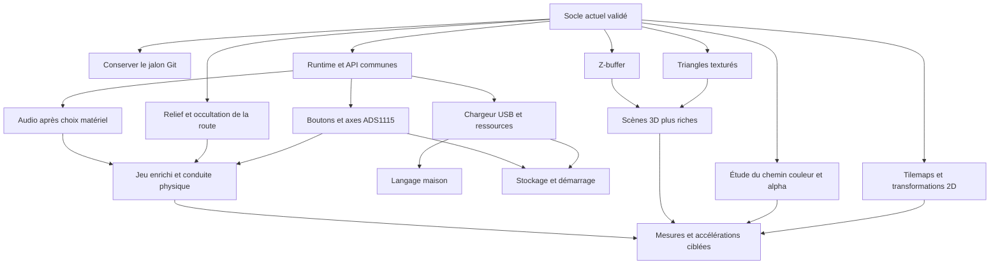

# Console de jeux Tang Mega 138K Pro Dock — feuille de route détaillée

État de référence : **29 septembre 2026**, après validation de `gpu_fast_r2`.

Ce document décrit les évolutions restantes de la console, du jeu de course
et de l'IP graphique. Il précise ce qui existe, ce qu'il faut modifier,
les dépendances, les limites et les preuves attendues pour terminer chaque lot.
Il constitue un plan de réalisation : les interfaces proposées, les noms des
futurs fichiers et les objectifs de performance ne sont pas des fonctions
déjà implémentées.

L'[architecture V2](ARCHI_V2_CONSOLE_JEUX.md) reste la référence de périmètre.
Le produit est une **console de jeux** : boutons, axes analogiques, LED,
graphismes, son et programmes. Les anciennes fonctions d'acquisition de
signaux de V1 ne font pas partie de cette feuille de route.

## Sommaire

1. [État actuel et résultats acquis](#etat)
2. [Contraintes à conserver](#contraintes)
3. [Vue d'ensemble des travaux](#lots)
4. [Conserver le jalon actuel](#jalon)
5. [Boutons, LED, ADS1115 et manettes](#entrees)
6. [Organisation du logiciel et API](#logiciel)
7. [Évolution du jeu de course](#jeu)
8. [Audio](#audio)
9. [Chargeur USB et ressources](#chargeur)
10. [Langage maison](#langage)
11. [Stockage persistant et démarrage autonome](#stockage)
12. [Extensions graphiques 2D](#graphique2d)
13. [Extensions 3D](#graphique3d)
14. [Accélérations supplémentaires](#accelerations)
15. [Budgets et instrumentation](#budgets)
16. [Validation et non-régression](#validation)
17. [Ordre de réalisation et décisions ouvertes](#ordre)
18. [Fichiers concernés et suivi](#suivi)

<a id="etat"></a>

## 1. État actuel et résultats acquis

### 1.1 Matériel et affichage

| Élément | État réellement acquis |
|---|---|
| Carte | Tang Mega 138K Pro Dock, boîtier FPG676. |
| CPU | AE350 à **800 MHz**, firmware C fonctionnel. |
| Bus | AHB/APB à **80 MHz**. |
| Mémoire | DDR3, accès CPU et GPU concurrents ; chemin graphique natif **256 bits / 32 octets**. |
| Domaine graphique | GPU et interface utilisateur DDR à **75 MHz**. |
| LCD | **800 × 480**, horloge pixel **35 MHz**. |
| Cadence nominale | `35 000 000 / (1 193 × 533)` ≈ **55,04 images/s**, période ≈ **18,17 ms**. |
| Format des images | Pixels indexés sur 8 bits, palette globale de 256 couleurs RGB666. |
| Présentation | Double tampon et changement de page au retour vertical. |
| Liaison PC | Console et commandes par UART2 / USB CDC. |

Les fréquences ci-dessus correspondent à la configuration validée. La cadence
nominale résulte des paramètres du générateur vidéo ; elle ne remplace pas
une mesure physique de la fréquence du panneau.

### 1.2 Fonctions graphiques déjà implémentées

| Fonction | Détail et limites actuelles |
|---|---|
| Pages DDR | Primitives du blitter : 16 emplacements de pages, pas d'adresse de 1 Mio, image utile de 384 000 octets par page. |
| 16 couches | Composition de surfaces, position, fenêtre, défilement, priorité, transparence de l'index zéro, validation atomique des descripteurs. |
| 64 sprites | Images de 1 à 32 pixels par axe, pas mémoire fixe de 32 octets, retournements X/Y, priorité entre les couches. |
| Cache des sprites | 64 Kio de BSRAM, rechargement des images actives au retour vertical. |
| Dessin 2D | Pixels, lignes, rectangles, cercles, disques, copies avec chevauchement et dégradés H/V/diagonaux. |
| Texte | Police programmable de 256 glyphes 8 × 16, échelles ×1/×2, fond transparent ou opaque selon le contrat G2. |
| Triangles pleins | Découpage à l'écran, coordonnées signées, règle de couverture haut/gauche, calcul des segments par ligne. |
| Zoom transparent | Opcode 11 : source de 1 à 128 pixels par axe, agrandissement/réduction au plus proche voisin, index zéro transparent. |
| Première 3D | Transformation et projection sur CPU, clipping proche, élimination des faces arrière, tri des faces, rendu filaire et faces unies. |
| Aplats accélérés | FILL, DISK et TRIANGLE utilisent une voie directe vers les écritures DDR de 256 bits. |
| Observation | Compteurs de commandes, erreurs, lignes manquantes et charge de composition. |

**Une page mémoire, une couche affichée et un sprite sont trois objets distincts.**
Le zoom actuel dessine une image dans une page DDR ; il ne transforme pas les
64 sprites de composition en sprites matériels de 128 × 128 ou à rotation libre.

La transparence actuelle choisit le pixel du dessous lorsque l'index vaut zéro.
Elle ne mélange pas les couleurs. La palette globale n'appartient pas à la
transaction atomique des tables de couches et de sprites.

### 1.3 Jeu de course déjà disponible

Le prototype **Mega Coast** possède déjà :

- une route à deux voies en perspective, des virages et des bordures alternées ;
- cinq voitures venant en face sur la voie gauche ;
- une voiture du joueur, des arbres, des balises et des montagnes ;
- le changement de taille apparent des objets selon leur distance ;
- l'accélération jusqu'à 180 km/h, le freinage et l'inertie ;
- la dérive en virage et le ralentissement sur l'herbe ;
- les collisions et une temporisation de protection ;
- un parcours de 6 km, le chronomètre, la distance, le nombre de chocs,
  l'arrivée et le redémarrage ;
- une simulation à pas fixe de 20 ms, indépendante de l'affichage ;
- des commandes au clavier, à la souris ou au toucher via la manette Web locale ;
- une alternative de commande dans une fenêtre native Tk ;
- un relâchement des commandes après perte de focus côté navigateur et un
  délai de surveillance de 350 ms côté firmware en cas de silence USB.

La route est encore plane en altitude. Le jeu utilise principalement le dessin
dans une page puis une couche affichée ; les capacités G3/G4 restent disponibles
pour les futurs usages. Voir [le jeu et son protocole](JEU_COURSE.md).

### 1.4 Accélération terminée pour conserver le premier rendu

Le premier rendu complet tournait à environ **27,7 images/s**. Une version
logicielle allégée utilisait ensuite un panorama en cache et des bordures plus
étroites. Le nouveau GPU permet de reprendre le rendu original à la cadence
du LCD, en recalculant son paysage à chaque image.

Modifications déjà réalisées :

1. Remplacement du parcours pixel par pixel de la boîte englobante des triangles
   par des intersections exactes avec les lignes de pixels.
2. Production de segments horizontaux avec progression entière des arêtes.
3. Écriture directe des aplats par blocs DDR de 32 pixels indexés, avec masques
   sur les extrémités.
4. Préparation possible du segment suivant pendant le transfert du précédent.
5. Raccourcissement d'un chemin critique du lecteur d'affichage, sans ajouter
   de cycle de composition ni changer les fréquences.
6. Conservation des deux modes du jeu et ajout d'un benchmark comparable.

| Mesure du rendu original, séquence de 240 images | Résultat |
|---|---:|
| Préparation CPU moyenne | 63,37 µs |
| Soumission + dessin GPU moyens | **8,10 ms** |
| Soumission + dessin GPU maximum | **9,79 ms** |
| Cadence calculée sur cette séquence | 55,11 images/s |
| Lignes manquantes | 0 |

La mesure de 55,11 images/s inclut une première attente de retour vertical
partielle ; la cadence nominale du panneau reste 55,04 Hz. Ces résultats
valent pour la séquence testée et ne garantissent pas le même temps pour
n'importe quelle future scène.

Les copies, dégradés, textes et zooms utilisent encore leur chemin précédent.
Aucun second tampon de ligne de dessin n'a été ajouté dans cette accélération.
Voir [l'architecture des segments DDR](GPU_SPANS_DDR256.md) et
[les résultats complets](../TESTS/TESTS_GPU_FAST.md).

<a id="contraintes"></a>

## 2. Contraintes à conserver

### 2.1 Matériel et horloges

- Conserver le cœur à **800 MHz** et les domaines validés à 80/75/35 MHz.
- Utiliser la **DDR3** pour les surfaces et ressources externes ; le Pro Dock
  de ce projet n'utilise pas de SDRAM.
- Réutiliser les domaines d'horloge existants : **8/8 ressources PRIMARY**
  sont déjà utilisées.
- Produire les cadences lentes des périphériques par activations synchrones
  lorsque cela convient, plutôt que supposer une nouvelle horloge globale libre.
- Vérifier le brochage et les niveaux électriques du **Pro Dock FPG676**
  avant tout ajout de bouton externe, ADC, manette ou sortie audio.
- Ne pas recopier automatiquement les contraintes de l'autre carte
  `../logic_analyser_wifi`.

### 2.2 Affichage et DDR

- Préserver la priorité temporelle des lectures nécessaires au LCD.
- Achever les écritures d'une image avant sa présentation au retour vertical.
- Conserver les barrières et la maintenance des caches CPU lors des échanges
  de propriété des surfaces.
- Signaler une surcharge par des compteurs exploitables ; ne pas présenter
  « 16 couches + 64 sprites » comme une charge illimitée par ligne.
- Conserver une sémantique déterministe des commandes, du découpage, des
  masques d'octets et de la fin de commande.
- Vérifier le placement/routage après chaque modification RTL. Le build de
  référence a une marge minimale de **+0,139 ns** : la marge de timing reste
  une contrainte réelle malgré la logique disponible.

### 2.3 Compatibilité logicielle

- Préserver les opcodes déjà utilisés par les jeux et les diagnostics.
- Versionner les nouvelles interfaces avant de leur attribuer une forme stable.
- Distinguer le compteur de commandes terminées d'un simple état « occupé ».
- Centraliser la soumission GPU : le format actuel suppose un seul producteur
  de mots de commandes à la fois.
- Garder une référence fonctionnelle du jeu pour comparer pixels et performances.

<a id="lots"></a>

## 3. Vue d'ensemble des travaux

Les identifiants ci-dessous servent au suivi de cette feuille de route.
Ils ne remplacent pas les jalons historiques G0 à G7.

| Lot | Contenu | Statut / priorité | Dépendances principales |
|---|---|---|---|
| L00 | Commit, push et archivage du jeu + GPU accéléré | À faire, immédiat | Sources et preuves actuelles |
| L01 | Boutons et événements d'entrée | À faire, priorité haute | Brochage, socle logiciel d'entrée |
| L02 | LED et sorties simples | À faire avec L01 | Brochage, registres disponibles |
| L03 | I²C et deux ADS1115 | À faire, priorité haute | Câblage, L01 pour l'API commune |
| L04 | Manette matérielle | Option à choisir | Modèle et protocole, L01 |
| L05 | Runtime et API de console | À faire progressivement | API GPU actuelle |
| L06 | Relief et enrichissement du jeu | À faire par incréments | Modèle de course, mesures GPU |
| L07 | Son et musique | À faire après choix de sortie | Matériel audio, L05, budget DDR/CPU |
| L08 | Chargeur USB de programmes et ressources | À faire | L05, carte mémoire et protocole |
| L09 | Interpréteur du langage maison | À faire | L05, L08 pour le chargement depuis le PC |
| L10 | Stockage et démarrage autonome | À faire après inventaire flash | L08, gestion du lancement et récupération |
| L11 | Tilemaps | Extension graphique utile | Format de ressources, composition |
| L12 | Rotation et transformations affines | Extension graphique | Échantillonnage, cache et DMA |
| L13 | Mélange alpha | Extension nécessitant une étude de format | Palette, composition et mémoire couleur |
| L14 | Triangles texturés | Extension 3D | Triangle, texture, interpolation et DDR |
| L15 | Z-buffer | Extension 3D | Surface profondeur, DMA, ordre des opérations |
| L16 | Transformations 3D par DSP | Conditionnel | Mesures prouvant un besoin CPU |
| L17 | Copies, dégradés, texte et zoom plus rapides | Conditionnel, ciblé par mesure | Profilage et conservation des références |
| L18 | Fiabilité, outils, documentation et diagnostics | Transversal | Chaque lot concerné |

Le jeu actuel n'a pas besoin de L11 à L17 pour retrouver sa fluidité : ce
problème est résolu sur la scène de référence. Ces lots augmentent les
possibilités graphiques ou la capacité des scènes futures.

<a id="jalon"></a>

## 4. L00 — Conserver le jalon actuel

### 4.1 Situation

Au relevé du 29 septembre, le dernier commit est `b5b0ef3`, consacré à G5.
Le jeu de course, le zoom et l'accélération GPU sont présents dans l'arbre de
travail mais ne sont pas encore enregistrés dans un commit ni poussés.

Le bitstream validé est
[console_gpu_fast_800.fs](../bitstreams/console_gpu_fast_800.fs), avec son
[fichier SHA-256](../bitstreams/console_gpu_fast_800.sha256).

```text
6aba70d8cac106e9cfed8ecd517d4c5e60cfdbd89f539bd271e1de5ef041d7ea
```

### 4.2 Actions restantes

- Relire le diff des sources, des outils, des tests et de la documentation.
- Enregistrer les images de référence et les journaux utiles au suivi.
- Conserver l'identité du build `gpu_fast_r2`, ses sources figées et ses mesures.
- Décrire dans le commit le résultat final : jeu de course, zoom et
  accélération conservant le rendu original à la cadence du LCD.
- Pousser le ou les commits, puis relever leur identifiant dans les documents
  de livraison si nécessaire.
- Garder le bitstream précédent comme point de retour.

Les changements locaux préexistants de `tang/impl/pnr/cmd.do` et
`tang/impl/pnr/device.cfg` doivent être examinés séparément ; leur présence
ne suffit pas à les rattacher au travail graphique.

### 4.3 Critères de fin

Les sources pertinentes, le bitstream, son empreinte et les preuves sont
reliés à une révision Git identifiable. Le dépôt distant contient cette
révision. Les fichiers locaux sans rapport restent préservés.

<a id="entrees"></a>

## 5. L01 à L04 — Boutons, LED, ADS1115 et manettes

### 5.1 Inventaire matériel préalable

Établir une table de câblage avant l'implémentation :

| Information à fixer | Utilité |
|---|---|
| Boutons embarqués utilisables et entrées du connecteur | Nombre d'actions et brochage de la manette simple |
| Polarité, résistances de rappel, niveaux des banques | État de repos et interface électrique correcte |
| LED disponibles, polarité, éventuels buffers | Commande logique et luminosité |
| Broches SDA/SCL et résistances du bus | Partage des deux ADS1115 |
| Modules ADS1115 réellement raccordés | Adressage, alimentation, câblage des axes |
| Ressources GPIO/I²C déjà exposées par le SoC | Réemploi des blocs disponibles avant d'en ajouter |
| Modèle de manette éventuel | Choix du protocole et du pilote |

Cette étape consulte les schémas et les documentations des composants
effectivement montés. Aucun nouveau numéro de broche n'est figé dans ce plan.

### 5.2 L01 — Boutons numériques

**Comportement recherché :** direction, accélération, freinage, départ et
pause, avec plusieurs touches simultanées et un état stable au repos.

Travail matériel :

- Synchroniser les signaux asynchrones dans le domaine de lecture choisi.
- Définir l'anti-rebond par entrée et exprimer sa durée en temps, avec une
  conversion explicite depuis la fréquence du domaine.
- Examiner le bloc existant `tang/rtl/board/key_debounce.v` avant réemploi :
  il contient un seuil commenté pour 50 MHz, à ne pas reprendre tel quel
  dans un domaine à 80 MHz.
- Exposer l'état stable ainsi que les fronts d'appui et de relâchement.
- Définir l'acquittement des événements et le comportement lorsqu'un front
  arrive pendant une lecture ou un effacement.
- Rendre la perte d'événements observable si une file est employée.

Travail logiciel :

- Introduire un état d'entrée commun aux boutons physiques et aux outils USB.
- Traduire les entrées en actions de jeu, sans numéro de broche dans le modèle.
- Définir une politique pour gauche + droite et accélérer + freiner.
- Lire les entrées sans attente bloquante dans la boucle de jeu.
- Distinguer état maintenu, appui récent et relâchement récent.
- Conserver le délai de surveillance pour les sources distantes ; une entrée
  physique locale ne dépend pas du trafic du navigateur.

**Validation :** simulation des rebonds et appuis simultanés, absence de
double événement pour un appui, maintien prolongé, retour au repos après
reset, fonctionnement pendant une scène graphique chargée. Sur carte,
effectuer un parcours avec les seuls boutons physiques.

### 5.3 L02 — LED et sorties numériques simples

Prévoir une API commune pour lire/configurer la direction d'une broche et
écrire un masque de sorties. Réutiliser les possibilités du GPIO du SoC
quand elles sont disponibles ; ajouter des registres spécifiques seulement
si le connecteur ou les besoins de jeu l'exigent.

Fonctions à réaliser :

- mise à 0/1 d'une sortie ou d'un groupe de sorties ;
- opérations de mise à un et d'effacement évitant les conflits entre mises
  à jour de bits indépendants ;
- valeur définie au démarrage et lors du retour au menu ;
- exemples : voyant de collision, départ, pause ou état de connexion ;
- PWM simple pour la luminosité si cette fonction est retenue.

Pour le PWM, fixer le nombre de canaux, la résolution et la fréquence utile
après inventaire. Employer un compteur et une activation synchrones ; les
sorties simples ne justifient pas de réintroduire un générateur de signaux
d'acquisition à haute fréquence.

**Validation :** masque de bits, direction, polarité, absence d'effet sur les
broches voisines, stabilité pendant le jeu, rapport cyclique si PWM ajouté.

### 5.4 L03 — I²C et deux ADS1115

**Usage :** volant ou joystick analogique, accélérateur, frein et autres
potentiomètres de commande. La cadence utile est celle d'une entrée de jeu.

Partie bus :

- Inventorier le contrôleur I²C utilisable, puis l'exposer dans un pilote commun.
- Implémenter les transactions nécessaires aux registres des ADC.
- Définir des délais maximaux pour les transactions et les conversions.
- Gérer composant absent, absence d'acquittement et bus indisponible.
- Documenter les adresses effectives des deux modules et éviter tout conflit.
- Prévoir une récupération du bus compatible avec le matériel choisi.

Partie ADC :

- Définir le mode de conversion, le gain, les canaux et leur séquence de lecture.
- Calculer le débit effectif **par axe** en tenant compte du multiplexage,
  du temps de conversion et des transactions ; le nombre de canaux ne
  multiplie pas la cadence disponible de chaque convertisseur.
- Prioriser les axes de conduite si toutes les entrées ne demandent pas
  la même fréquence de mise à jour.
- Publier pour chaque axe une valeur brute, une valeur normalisée, un
  horodatage et un indicateur de validité.
- Ne pas bloquer le rendu en attendant une nouvelle conversion.

Calibration et comportement :

- mesurer minimum, centre et maximum des axes qui ont une position centrale ;
- gérer les axes unipolaires comme une pédale ;
- appliquer inversion, zone morte et saturation ;
- ajouter un filtrage modéré et mesurer le retard qu'il introduit ;
- définir un retour à une valeur neutre lorsqu'une mesure devient périmée ;
- prévoir une page de réglage, puis la sauvegarde des paramètres avec L10.

**Validation :** valeurs aux extrémités et au centre, bruit au repos,
changement de canal, fonctionnement des deux ADC ensemble, module absent,
mesure périmée et jeu sous charge graphique. Mesurer la latence complète
« mouvement du potentiomètre → état utilisable par la simulation ».

### 5.5 L04 — Manette matérielle éventuelle

Le protocole doit être choisi avant l'implémentation.

| Possibilité à étudier | Travail correspondant |
|---|---|
| Boutons + joystick analogique | L01 et L03 ; solution directe pour la première manette |
| Manette à protocole série simple | Interface électrique, séquenceur, décodage et temporisation propres au modèle |
| Manette USB HID | Vérification d'un matériel hôte USB utilisable, pile hôte, énumération et interprétation des rapports |
| Interface intermédiaire | Définition du protocole entre l'adaptateur et la console, gestion de la perte de liaison |

Le périphérique USB CDC actuel relie la console au PC ; il ne fournit pas à
lui seul un hôte USB capable d'accueillir une manette HID.

Le pilote choisi doit produire le même état d'entrée que les boutons et ADC :
actions, axes, état de connexion. Définir la sélection de la source active
pour éviter une lutte entre navigateur et manette physique.

**Validation :** connexion, déconnexion, axes, touches simultanées, neutralité
en cas de perte de liaison et essai prolongé pendant une course.

<a id="logiciel"></a>

## 6. L05 — Organisation du logiciel et API de console

### 6.1 Séparer le runtime, les diagnostics et les jeux

Le firmware courant est construit autour de `gpu_diag.c`, avec des scènes
et démonstrations incluses depuis des fichiers d'en-tête. Cette organisation
permet de valider le matériel mais doit évoluer pour héberger plusieurs jeux.

Répartition proposée, noms encore indicatifs :

| Ensemble | Responsabilité |
|---|---|
| `runtime/` | Initialisation, temps, boucle principale, lancement/arrêt d'une application |
| `drivers/` | GPU, entrées, I²C/ADC, audio, USB, stockage |
| `games/racer/` | État du jeu, physique, circuit, projection et rendu |
| `diag/` | Tests G0–G6, comparaisons de pixels, benchmarks et commandes techniques |
| `assets/` | Description des palettes, images, polices, sons et circuits |
| `lang/` | Analyse et exécution du langage maison |

La migration peut se faire par petites étapes. Les fichiers existants restent
les points de départ ; il n'est pas nécessaire de déplacer tout le dépôt
avant de brancher les premiers boutons.

### 6.2 API graphique

Construire l'API stable à partir de [gpu.h](../fw_console/gpu.h) et de son
implémentation, en conservant le pilote de bas niveau accessible aux diagnostics.

Contrats à formaliser :

- création/réservation d'une surface et durée de vie de ses pixels ;
- distinction entre emplacement de page du blitter et adresse libre de surface ;
- publication d'une surface CPU vers le GPU et lecture inverse après achèvement ;
- dessin, copie, texte, triangle et zoom ;
- mise à jour des tables de couches et de sprites ;
- attente d'un ensemble de commandes puis présentation au retour vertical ;
- appartenance et mise à jour de la palette globale et de la police ;
- délais maximaux, erreurs et récupération en cas de GPU indisponible ;
- information de capacités pour les futures commandes optionnelles.

Les compteurs bornés, dont `DONE` sur 16 bits, doivent être traités modulo
leur taille avec une limite explicite sur le travail en attente.

### 6.3 API d'entrée, temps et audio

- Fournir un instantané cohérent des touches et axes par pas de simulation.
- Conserver un temps de simulation indépendant du nombre d'images affichées.
- Définir le rattrapage après un retard, avec un nombre borné de pas pour ne
  pas monopoliser la boucle principale.
- Remettre les commandes à un état défini lors d'un changement de jeu.
- Faire démarrer/arrêter un son par événement sans attente de sa lecture complète.
- Exposer les compteurs de performance au diagnostic sans imposer leur
  affichage dans l'interface normale du jeu.

### 6.4 Gestion de la mémoire

Le linker actuel réserve **64 Kio d'ITCM**, **64 Kio d'ILM** et **32 Kio de DLM**.
L'image de référence occupe 48 112 octets d'ITCM ; sa BSS mesure 27 344 octets
en ILM. La BSS seule ne donne pas l'occupation totale des données.

Travaux :

- surveiller séparément code, constantes, données initialisées, BSS et pile ;
- garder les gros atlas, sons et programmes chargés dans la DDR ;
- définir une carte mémoire commune aux jeux, au chargeur et aux diagnostics ;
- réserver explicitement les pages de travail plutôt que compter sur des
  numéros fixes disponibles par hasard ;
- borner les allocations et restituer les ressources à l'arrêt d'un jeu ;
- définir le comportement si une ressource manque ou si l'image ITCM est trop grande.

**Validation :** mêmes empreintes du jeu après séparation du code, mêmes
commandes de diagnostic, taille mémoire maîtrisée et séquence répétée
« lancer → jouer → arrêter → relancer » sans fuite de ressources.

<a id="jeu"></a>

## 7. L06 — Évolution du jeu de course

### 7.1 Circuit décrit par des données

Remplacer progressivement le circuit principalement procédural par une
description de segments : longueur, courbure, altitude, largeur, apparence
des bordures, décor et événements éventuels.

Le format doit permettre :

- des enchaînements de virages reproductibles ;
- une transition continue entre deux segments ;
- plusieurs circuits sans modifier le moteur de projection ;
- une graine ou une liste déterministe pour comparer deux versions ;
- une limite explicite sur les segments et objets visibles par image.

Conserver le parcours actuel comme scène de régression et premier circuit.

### 7.2 Montées, descentes et horizon

Ajouter une altitude au profil longitudinal de la route et une hauteur de
caméra. Projeter les points de la chaussée en tenant compte de l'élévation.

Travail à prévoir :

1. Interpoler l'altitude et la pente entre les segments.
2. Adapter la position de la caméra sans saut brutal à une jonction.
3. Découper les segments proches pour éviter une division par une profondeur
   nulle ou trop faible.
4. Construire les triangles de route et de bordure avec une couverture continue.
5. Ajuster la position apparente de l'horizon et du panorama.
6. Borner les tailles projetées et les coordonnées avant soumission au GPU.

Cette évolution peut rester un rendu de route en perspective avec objets 2D.
Elle ne dépend pas obligatoirement d'un Z-buffer ou des textures de triangles.

### 7.3 Masquage derrière les bosses

Le tri par distance des voitures ne suffit plus lorsqu'une portion de route
cache une autre portion plus lointaine.

Prévoir :

- une information d'occlusion issue du profil de route visible ;
- le rejet des segments entièrement cachés ;
- le découpage vertical des voitures et éléments de décor partiellement cachés ;
- la réapparition progressive des objets au-dessus d'une crête ;
- une stratégie plus riche si le profil n'est pas uniforme sur toute la largeur.

Un masque ou une limite de visibilité pour une route à hauteur unique par
section est une première solution à étudier. Les ponts, routes superposées
et croisements avec géométrie indépendante constituent une extension distincte.

**Validation :** crête devant un véhicule, descente suivie d'une montée,
virage au sommet, objet partiellement visible et proximité de la caméra ;
aucun véhicule ne doit traverser visuellement une portion de route opaque.

### 7.4 Décor et identité visuelle

- Ajouter plusieurs variantes de véhicules et d'arbres.
- Introduire panneaux, glissières, bâtiments ou autres éléments de bord de route.
- Organiser des zones visuelles cohérentes le long du circuit.
- Exploiter les couches pour le ciel, le paysage lointain et l'interface
  lorsque cela réduit le travail sans dépasser le budget de composition.
- Définir une palette partagée entre véhicules, route, décor et interface.
- Préparer des images de référence pour valider les changements de palette.

Un outil d'import d'images doit réserver explicitement l'index transparent,
contrôler les dimensions et produire les formats mémoire attendus. Les grands
objets peuvent utiliser le zoom dans une page ; les petits objets indépendants
peuvent employer les sprites G4 si le coût de composition le permet.

### 7.5 Voitures, trafic et conduite

- Préparer plusieurs vues de la voiture du joueur selon la direction.
- Ajouter des indications de freinage et des animations de collision.
- Varier l'apparence et, si retenu, la vitesse des voitures adverses.
- Définir des règles de réapparition évitant un obstacle impossible à anticiper.
- Adapter les collisions au modèle de route sans les déduire uniquement
  du chevauchement des rectangles projetés à l'écran.
- Conserver une temporisation de protection après choc.
- Ajuster la difficulté avec des paramètres documentés et reproductibles.

Le trafic venant en sens inverse existe déjà. Des voitures dans le même sens,
des dépassements ou une intelligence de changement de voie sont des options
supplémentaires à sélectionner, pas des prérequis du jeu demandé.

### 7.6 Interface et progression

L'écran de départ, l'arrivée et le redémarrage existent. Les compléments
possibles sont :

- un vrai menu de sélection du circuit et des commandes ;
- la pause avec gel du chronomètre et de la simulation ;
- un écran de réglage des axes analogiques ;
- un résultat de fin de parcours plus détaillé ;
- des checkpoints ou un score si une règle de jeu est choisie ;
- des records persistants lorsque L10 sera disponible.

Définir la machine d'états du jeu : menu, attente de départ, course, pause,
arrivée et retour au menu. Les diagnostics USB restent accessibles selon
une politique explicite ; ils ne doivent pas modifier une page active à
l'insu de la boucle de jeu.

### 7.7 Critères de fin du lot course

- Parcours complet jouable avec les commandes physiques retenues.
- Relief et occultation corrects sur les scènes de référence.
- Physique identique pour une même séquence d'entrées, quel que soit le
  nombre d'images effectivement affichées.
- Aucun dépassement de tableau de commandes ou de liste d'objets.
- Zéro ligne manquante sur les parcours de validation.
- Temps CPU/GPU et maximum par image publiés pour la nouvelle complexité.
- Aucun retour visuel dégradé introduit uniquement pour masquer un coût
  non mesuré ; les choix graphiques sont explicites.

<a id="audio"></a>

## 8. L07 — Audio

### 8.1 Choisir et vérifier la sortie

Inventorier la sortie audio réellement disponible sur cette révision de
Pro Dock : composant, brochage, horloges, signaux de commande et connecteur.
Confirmer s'il faut utiliser un DAC présent sur la carte, une interface
numérique ou un module externe. Le pilote et les contraintes dépendront de
ce choix ; ce document n'attribue pas arbitrairement une interface à la carte.

Fixer ensuite fréquence d'échantillonnage, format, nombre de canaux, volume
et comportement silencieux au démarrage. Ces valeurs doivent découler du
matériel retenu et du budget logiciel.

### 8.2 Première version fonctionnelle

- Sortir un signal de test puis lire un échantillon sonore connu.
- Prévoir des tampons alternés ou une file d'échantillons.
- Alimenter la sortie sans dépendre d'une attente GPU ou du retour vertical.
- Compter les manques d'échantillons et définir une sortie contrôlée dans ce cas.
- Définir le transfert DDR → tampon audio si les sons résident en DDR.
- Vérifier la concurrence avec l'affichage et le blitter.

Commencer par un mixage logiciel sur le CPU si les mesures le permettent.
Un mélangeur matériel, une interpolation plus coûteuse ou une décompression
ne deviennent des lots spécifiques que si la charge le justifie.

### 8.3 Intégration dans le jeu

Premiers sons proposés :

- moteur, avec variation liée à la vitesse ou à un régime simplifié ;
- freinage et sortie sur l'herbe ;
- collision ;
- départ, arrivée et actions de menu ;
- musique de fond en étape suivante.

Définir les priorités des voix, leur nombre maximal, le volume global et
l'arrêt des sons lors d'une pause ou d'un changement d'application. Prévoir
une saturation correcte du mélange pour éviter le repliement numérique.

**Validation :** écoute sur la sortie retenue, cadence d'échantillonnage,
absence de rupture sous charge graphique, plusieurs effets simultanés,
pause/reprise, compteur de sous-alimentation nul sur la scène cible.

<a id="chargeur"></a>

## 9. L08 — Chargeur USB de programmes et ressources

### 9.1 Résultat attendu

Après chargement d'un firmware de console stable, transférer un jeu ou ses
ressources depuis le PC et le lancer **sans reconstruire le FPGA**.

Aujourd'hui, le programme C est incorporé dans l'initialisation ITCM du
bitstream. La liaison CDC transporte déjà diagnostics et commandes de jeu,
mais elle ne constitue pas encore un chargeur général de programmes.

### 9.2 Distinguer les types de contenu

| Contenu | Traitement prévu |
|---|---|
| Images, polices, palettes, sons, circuits | Vérification du format, transfert en DDR, publication aux consommateurs |
| Source ou bytecode du langage maison | Stockage en DDR, validation et exécution par le runtime/interpréteur |
| Programme C natif | Extension séparée nécessitant un contrat d'exécution et de liaison |

La première version peut charger des ressources pour une application intégrée,
puis des programmes du langage maison. L'exécution native depuis une zone
chargée doit être étudiée et prouvée sur cette configuration avant d'être
annoncée : placement du code, caches d'instructions, ABI, point d'entrée,
retour au runtime et accès aux services système.

### 9.3 Protocole de transfert proposé

Définir une trame binaire versionnée contenant au minimum : type de message,
identifiant de transfert, numéro de bloc, longueur et contrôle d'intégrité.
Choisir et documenter précisément l'encodage et le calcul du contrôle
d'intégrité lors de l'implémentation.

Fonctions logiques à fournir, noms de commandes non figés :

- interrogation de version et de capacités ;
- début de transfert avec type, taille et destination logique ;
- envoi et acquittement des blocs ;
- vérification du contenu complet ;
- validation atomique du programme ou de la ressource ;
- lancement, arrêt et retour au menu ;
- annulation et compte rendu d'erreur.

Le récepteur doit gérer :

- découpage arbitraire des données par la liaison CDC ;
- trame incomplète, taille excessive ou contenu incohérent ;
- bloc perdu ou dupliqué selon la politique de retransmission choisie ;
- interruption d'un transfert et nouvel essai ;
- délai dépassé sans immobiliser indéfiniment la console ;
- resynchronisation après une erreur de protocole ;
- distinction entre messages de diagnostic textuels et données binaires.

Les écritures restent limitées aux zones allouées au transfert. Le nouveau
protocole ne doit pas exposer les registres matériels comme de simples
destinations mémoire de fichier.

### 9.4 Intégration avec le jeu et la DDR

- Définir si le chargement met le jeu en pause ou utilise un budget en arrière-plan.
- Transférer dans une zone temporaire avant de remplacer une ressource active.
- Publier les nouvelles images au GPU seulement après validation complète.
- Garder une ressource utilisée par une image en cours jusqu'à sa libération.
- Relâcher les commandes lors d'un changement de programme.
- Fournir une progression et une erreur compréhensibles sur l'outil PC et,
  si utile, sur le LCD.

### 9.5 Outil PC

Créer un outil de chargement utilisant le même mécanisme de sélection du
port CDC que les outils existants. Il doit vérifier la compatibilité de
version, afficher la progression, permettre l'annulation et quitter avec
un état de succès ou d'échec fiable.

Un seul propriétaire du port CDC est admis à la fois. Une intégration avec
la manette Web pourra être proposée après le chargeur en ligne de commande.

**Validation :** transferts de plusieurs tailles et limites de blocs, contenu
corrompu, interruption au milieu d'une trame, manque de mémoire, relancement
après erreur et conservation de l'image affichée pendant un échec de chargement.

<a id="langage"></a>

## 10. L09 — Langage maison

### 10.1 Périmètre

Implémenter un langage de jeux utilisant les fonctions de la console sans
exiger une recompilation du firmware pour chaque programme. L'idée du langage
maison est conservée de l'architecture initiale ; sa grammaire reste à figer
en cohérence avec le matériel actuellement implémenté.

La grammaire de V1 est une proposition historique. Ses anciens nombres de
pages, dimensions d'écran et fonctions d'acquisition ne constituent pas une
spécification à reprendre automatiquement.

### 10.2 Première version du langage

Spécifier avant codage :

- variables entières, constantes, tableaux et limites de taille ;
- priorités des opérateurs et comportement des dépassements ;
- conditions et boucles ;
- mécanisme de sous-programmes et limites de profondeur ;
- chaînes, longueur maximale et encodage pour le texte affiché ;
- représentation des valeurs fractionnaires utiles aux animations ;
- erreurs de syntaxe et d'exécution avec ligne ou position exploitable ;
- arrêt d'un programme et restitution de ses ressources.

Un interpréteur C sur AE350 est un point de départ cohérent avec l'existant.
Une compilation vers bytecode peut réduire le coût d'exécution ; elle doit
être choisie sur un exemple représentatif plutôt que supposée nécessaire.

### 10.3 Services exposés au programme

| Domaine | Services à relier au runtime |
|---|---|
| Vidéo | Surface de dessin, primitives, texte, palette, triangle, zoom |
| Composition | Couches, sprites, position, défilement, image et priorité |
| Synchronisation | Présentation au retour vertical, attente bornée, temps écoulé |
| Entrées | État des touches, événements, axes calibrés |
| Sorties | LED et PWM retenu |
| Audio | Jouer/arrêter un effet, volume, musique si disponible |
| Ressources | Chargement logique d'une image, d'une police, d'un son ou d'un circuit |
| Diagnostic | Erreur du programme, statistiques de temps en mode développement |

Les opérations matérielles passent par les mêmes API C que les jeux intégrés.
Le langage ne doit pas reproduire une deuxième implémentation de la cohérence
des caches ou des descripteurs GPU.

### 10.4 Ordonnancement et erreurs

- Borner le nombre d'instructions exécutées entre deux retours au runtime.
- Rester capable de traiter une commande d'arrêt pendant une boucle infinie.
- Détecter les indices hors tableau, les divisions invalides et le manque de mémoire.
- Relâcher les entrées et arrêter les sons lors d'un arrêt ou d'une erreur.
- Afficher l'erreur puis revenir à un état permettant un nouveau chargement.

### 10.5 Démonstrations de validation

1. Texte et dessin de primitives.
2. Sprite animé contrôlé par les boutons ou un axe analogique.
3. Défilement de plusieurs couches avec interface fixe.
4. Petite scène 3D avec les services déjà disponibles.
5. Petit jeu complet chargé par USB, arrêté puis remplacé sans reconstruction FPGA.

**Critères de fin :** syntaxe documentée, exemples exécutables, erreurs
reproductibles, arrêt fiable et mesures de temps pour une scène animée.
Le portage du jeu de course entier vers le langage est une étape ultérieure
à évaluer, pas un prérequis pour valider l'interpréteur.

<a id="stockage"></a>

## 11. L10 — Stockage persistant et démarrage autonome

### 11.1 Deux persistances différentes

Il faut distinguer :

1. La configuration du FPGA au démarrage, permettant de retrouver le runtime
   après coupure de l'alimentation.
2. Les programmes, ressources, réglages et records conservés par la console.

Le bitstream de référence a été chargé en **SRAM** ; la flash n'a pas été
modifiée lors de cette validation. Le jeu conservé dans ce chargement ne
constitue donc pas à lui seul un démarrage autonome persistant.

### 11.2 Inventaire et carte de stockage

Avant d'écrire un pilote, identifier : composant de stockage, capacité,
interface accessible au CPU/FPGA, organisation du démarrage et régions
déjà utilisées par la configuration de la carte.

Définir ensuite :

- les régions réservées à la configuration et au runtime ;
- une zone de programmes et ressources ;
- une zone de réglages et records ;
- une stratégie de mise à jour et une procédure de récupération ;
- les unités d'effacement et les contraintes d'écriture réelles du composant.

Ce plan ne suppose pas que toute la flash soit libre ni accessible directement
par le logiciel. Le choix d'un autre support reste possible si l'inventaire
le rend préférable.

### 11.3 Format de contenu

Une première version peut utiliser un catalogue simple : nom, type, version,
taille, emplacement, contrôle d'intégrité et état de validité de chaque objet.
Un système de fichiers complet n'est pas indispensable pour quelques jeux.

Prévoir :

- écriture d'une nouvelle version avant validation du catalogue ;
- détection d'un contenu interrompu ou corrompu ;
- compatibilité entre versions du runtime et des programmes ;
- limitation des écritures fréquentes de records ou de réglages ;
- retour au menu si le programme sélectionné ne peut pas démarrer.

### 11.4 Expérience autonome

Au démarrage : initialiser le matériel, retrouver les réglages, afficher le
menu et proposer les jeux valides. Le contrôle doit être possible avec les
entrées physiques. L'USB reste disponible pour le développement et l'ajout
de contenu.

**Validation :** démarrage après coupure complète, conservation de la
calibration et des records, programme invalide, catalogue incomplet, stockage
plein et interruption d'une mise à jour sur une zone de test prévue à cet effet.

<a id="graphique2d"></a>

## 12. L11 à L13 — Extensions graphiques 2D

### 12.1 L11 — Tilemaps

**But :** représenter un décor par une grille de petites images réutilisables,
au lieu de stocker ou redessiner systématiquement une grande surface entière.
Cette fonction est particulièrement utile à de futurs jeux de plateforme,
de parcours ou à des cartes vues de dessus.

Définir :

- les dimensions de tuiles prises en charge ;
- le format de la grille et l'index de tuile ;
- les attributs éventuels : retournements, banque de palette, priorité ;
- les dimensions de la carte, son pas et ses règles de bouclage ;
- le défilement en pixels ;
- le comportement d'une case vide ou transparente.

Deux approches à comparer :

| Approche | Conséquences |
|---|---|
| Dessiner les tuiles dans une page DDR | Réutilise le blitter et les couches ; met à jour les zones exposées lors du défilement |
| Lire une tilemap directement pendant la composition | Évite une surface complète mais ajoute adressage, cache et charge au budget de ligne |

La première peut fournir un service logiciel utile avant une extension RTL.
La seconde demande une mesure de latence et une intégration explicite dans
les 16 couches ; ne pas multiplier les lectures DDR imprévisibles par pixel.

**Validation :** défilement horizontal/vertical, passage d'une limite de tuile,
carte non carrée, bords, transparence, modifications locales et concurrence
avec les sprites.

### 12.2 L12 — Rotation et transformations affines

Le zoom transparent actuel reste la référence pour le cas sans rotation.
Étendre le dessin d'images avec une transformation inverse, de la destination
vers la source, pour déterminer quel texel lire à chaque pixel couvert.

Fonctions proposées :

- rotation autour d'un point d'ancrage ;
- échelles indépendantes X/Y ;
- retournements ;
- cisaillement si utile ;
- découpage de la destination sans décaler la correspondance avec la source ;
- transparence de l'index zéro.

Travaux techniques :

- définir les coefficients, leur représentation fixe, leurs limites et arrondis ;
- calculer une boîte de destination bornée ;
- traiter les échantillons hors de la source ;
- organiser les lectures en cache malgré les parcours non contigus ;
- conserver une fin de commande après les dernières écritures acceptées ;
- prévoir un opcode versionné ou une extension explicitement détectable.

Commencer par le rendu dans une page DDR. Ajouter une transformation directement
dans le compositeur de sprites serait un autre changement, soumis à une
contrainte par ligne bien plus stricte. Le filtrage bilinéaire reste une
option distincte du plus proche voisin.

**Validation :** identité, rotations cardinales, angles intermédiaires,
réduction, agrandissement, coordonnées négatives, découpage aux quatre bords,
coefficients extrêmes et masques de transparence.

### 12.3 L13 — Mélange alpha

**But :** obtenir des ombres, fumées, transparences partielles, fondus et
interfaces translucides.

Le mélange doit porter sur les couleurs, pas sur la valeur numérique des
indices de palette. Pour un alpha normalisé, le principe est :

```text
couleur_sortie = alpha × couleur_source + (1 − alpha) × couleur_fond
```

La palette actuelle est appliquée après la composition indexée. À ce stade,
la couleur du pixel masqué a déjà été écartée. Une alpha réelle demande donc
une modification du chemin couleur ou une autre représentation du résultat.

Options à étudier :

| Option | Effet sur l'architecture |
|---|---|
| Alpha uniforme par couche ou sprite | Attribut simple, mais conservation et mélange des couleurs dans le compositeur |
| Alpha par pixel | Format ou plan alpha supplémentaire, davantage de lectures et de cache |
| Mélange dans le blitter | Lecture du fond et écriture du résultat ; nécessite un format couleur ou une règle de quantification |
| Palette de résultats précalculés | Approximation ou table spécifique, dépendance aux palettes ; à distinguer d'un mélange couleur général |

Décider explicitement :

- nombre de niveaux d'alpha et emplacement de la valeur ;
- conservation de l'index zéro transparent ;
- format de la couleur intermédiaire et des tampons de composition ;
- arrondis, saturation et ordre des couches ;
- fonctionnement avec les sprites et coût d'une ligne chargée ;
- stratégie de mise à jour de palette pendant les animations.

Une extension vers un format couleur direct peut être pertinente pour ce lot
et les textures, mais elle n'est pas nécessaire au jeu actuel. Son coût DDR
et BSRAM doit être chiffré avant de figer la solution.

**Validation :** alpha nul/opaque/intermédiaire, plusieurs surfaces empilées,
couleurs extrêmes, arrondis de référence, changements de palette, priorités
et mesure du budget de composition.

<a id="graphique3d"></a>

## 13. L14 à L16 — Extensions 3D

### 13.1 Limite de la 3D actuelle

Les triangles pleins et les transformations CPU sont opérationnels. Le tri
des faces convient aux premières scènes mais ne résout pas toutes les
intersections. Les deux capacités principales à ajouter sont la texture
des faces et un test de profondeur par pixel.

Ces capacités sont indépendantes au départ : on peut valider une texture
sur des triangles triés et un Z-buffer sur des triangles de couleur uniforme.
Leur intégration commune forme ensuite un moteur 3D plus général.

### 13.2 L14 — Triangles texturés

Première étape proposée : textures indexées, plus proche voisin et
interpolation affine, avec les limites visuelles documentées.

Informations nouvelles à transmettre :

- coordonnées des sommets ;
- coordonnées de texture associées ;
- surface de texture, dimensions et pas ;
- mode hors texture : découpage, répétition ou limitation aux bords ;
- transparence éventuelle ;
- paramètres de profondeur quand L15 est activé.

Le format actuel de commande compte huit mots de 32 bits. Les attributs
supplémentaires peuvent nécessiter une table de descripteurs, une commande
étendue ou un autre mécanisme. Définir d'abord son atomicité et sa compatibilité
avec la FIFO, sans modifier silencieusement les commandes existantes.

Travaux du rasteriseur :

1. Conserver la couverture exacte des pixels des triangles G5.
2. Initialiser les interpolateurs de texture sur les segments visibles.
3. Faire progresser les attributs malgré le découpage à l'écran.
4. Regrouper ou cacher les lectures de texels.
5. Appliquer la transparence avant une écriture de couleur/profondeur.
6. Tenir les données stables pendant la contre-pression DDR.

L'interpolation affine peut déformer une texture en perspective. Une deuxième
étape ajoutera la correction de perspective, par exemple avec interpolation
de `u/z`, `v/z` et `1/z`, après étude du coût et des erreurs d'arrondi.
Le filtrage bilinéaire et les niveaux de détail restent des extensions possibles.

**Validation :** damier, quadrilatère constitué de deux triangles, arêtes
communes, textures non carrées, clipping proche, fort angle de vue,
coordonnées négatives et accès DDR bloqués temporairement.

### 13.3 L15 — Z-buffer

**But :** décider de la visibilité à chaque pixel, y compris lorsque deux
triangles se croisent ou que le tri des faces ne suffit plus.

Contrats à définir :

- profondeur stockée : `z`, profondeur normalisée ou profondeur réciproque ;
- nombre de bits, plage, précision et valeur d'effacement ;
- sens de comparaison et règle en cas d'égalité ;
- interpolation cohérente avec la projection choisie ;
- écriture ou non de profondeur pour un pixel transparent ;
- activation par commande ou par cible ;
- association entre une surface couleur et une surface profondeur.

Pour un exemple en profondeur **16 bits**, une surface 800 × 480 utilise
**768 000 octets**. Couleur indexée + profondeur demandent **1 152 000 octets**
par couple, hors alignement. Deux couples utilisent **2 304 000 octets**.
Le double tampon de profondeur est un choix d'ordonnancement : une surface
de profondeur unique peut suffire si elle n'est pas utilisée par l'affichage
et si les rendus successifs sont strictement séquencés.

Travail mémoire et pipeline :

- lecture de la profondeur avant décision ;
- écriture masquée de couleur et de profondeur en cas de réussite ;
- gestion des fragments proches dans le pipeline qui visent le même pixel ;
- garantie qu'une lecture ne compare pas une profondeur rendue périmée par
  une écriture encore en attente ;
- effacement accéléré ou autre stratégie d'initialisation ;
- buffers/cache de profondeur dimensionnés pour les rafales DDR ;
- comptage des fragments testés, rejetés et écrits.

Le Z-buffer traite d'abord les surfaces opaques. Les faces semi-transparentes
demandent une politique de tri et d'écriture de profondeur distincte.

**Validation :** triangles croisés soumis dans les deux ordres, plans proches,
égalité de profondeur, clipping, effacement entre images, transparence et
cohérence sous attentes DDR. Une scène opaque doit retrouver le même résultat
lorsque l'ordre de soumission est inversé, hors égalités définies autrement.

### 13.4 L16 — Transformations par DSP, seulement si utiles

Le CPU prépare actuellement le rendu original de la course en moyenne en
63,37 µs sur la séquence mesurée. Cela ne justifie pas de déplacer immédiatement
toute la géométrie vers un moteur matériel.

Mesurer d'abord des scènes 3D plus riches : nombre de sommets, coût des matrices,
projection, clipping et tri. Si le CPU devient limitant, envisager :

- multiplication matrice/vecteur en arithmétique fixe ;
- pipeline utilisant les DSP disponibles ;
- file de sommets et matrices ;
- résultat DMA ou file accessible au CPU/rasteriseur ;
- formats et saturation compatibles avec la référence logicielle.

**Validation :** comparaison numérique avec le CPU, cas limites, coût
préparation/transfert compris et gain mesuré sur une scène complète.

<a id="accelerations"></a>

## 14. L17 — Accélérations supplémentaires

### 14.1 Principe de sélection

Profiler une scène représentative avant de modifier un chemin matériel.
Le gain attendu doit porter sur le temps total de rendu ou sur sa marge,
pas seulement sur le nombre de cycles d'un petit bloc isolé.

Les aplats et triangles bénéficient déjà du transfert direct. Les autres
primitives conservent un tampon de ligne et un chemin de préparation plus
séquentiel ; elles constituent les candidats suivants.

### 14.2 Copies de rectangles et de pages

Étudier une lecture/écriture native par blocs, avec extraction et réalignement
des octets lorsque la source et la destination n'ont pas le même alignement.

Préserver :

- la sémantique `memmove` en cas de chevauchement horizontal ou vertical ;
- le découpage simultané de la source et de la destination ;
- les octets hors rectangle dans les premiers et derniers blocs ;
- l'ordre correct des transferts et la fin réelle des écritures.

Tester les 32 alignements possibles, de petites largeurs, les limites de
ligne, les copies inversées et des attentes DDR variables. Comparer en
particulier le coût du panorama en cache avec celui du paysage redessiné.

### 14.3 Dégradés

Produire plusieurs indices par cycle ou par bloc, puis les transmettre au
DMA large. Conserver exactement les arrondis et la saturation du dégradé
actuel afin que l'accélération ne change pas les images de référence.

La finesse visuelle dépend aussi des rampes disponibles dans la palette.
Un générateur plus rapide ne crée pas de nouvelles couleurs au-delà du
format indexé. Une modification de palette et une modification de débit
doivent donc être évaluées séparément.

### 14.4 Texte

Étudier la génération groupée des pixels d'un glyphe, l'agrandissement ×2
et les masques de fond transparent. Mesurer les longues chaînes et l'interface
du jeu avant de choisir un cache supplémentaire.

Conserver la police programmable et la règle imposant l'achèvement des
commandes de texte avant modification de la police utilisée.

### 14.5 Zoom

Le zoom possède déjà un cache de ligne source réutilisé lorsque plusieurs
lignes cibles prennent la même ligne source. Améliorations possibles :

- production de plusieurs pixels destination par cycle ;
- duplication rapide lors des forts agrandissements ;
- préparation de masques de transparence sur un bloc de sortie ;
- meilleure réutilisation du cache et du DMA large ;
- préchargement de la prochaine ligne si la bande passante et les BSRAM le permettent.

Conserver l'échantillonnage fixe actuel, les cas de source invalide et le
comportement des échantillons hors limites. L'ajout de rotation relève de
L12 et ne doit pas être confondu avec l'accélération du zoom existant.

### 14.6 Chevauchement calcul/transfert

Un second tampon peut permettre de préparer une ligne pendant le transfert
de la précédente pour les opérations qui utilisent encore ce chemin.
Évaluer ce bénéfice avant d'allouer de la BSRAM supplémentaire.

Il faut alors définir la propriété des deux tampons, leur ordre de vidage,
la propagation de la contre-pression et la condition de fin de commande.
Tester les blocages longs et les changements de primitive pour détecter
une réutilisation prématurée des données.

### 14.7 Critère d'acceptation

Une accélération conserve les pixels, les gardes mémoire, le comportement
des commandes et les contraintes de timing. Son compte rendu inclut le gain
mesuré, la charge testée et le coût en logique/BSRAM/DSP. L'ajout d'un DMA de
listes de commandes n'est à envisager que si la soumission CPU devient elle
aussi mesurablement limitante.

<a id="budgets"></a>

## 15. Budgets et instrumentation

### 15.1 Ressources de référence : ensemble de la console

Ces chiffres proviennent du placement/routage de `gpu_fast_r2` et incluent
USB, pont CPU, contrôleur DDR, vidéo et autres blocs présents. **Ce ne sont
pas les chiffres de l'IP vidéo isolée.**

| Ressource | Occupation de toute la console | Capacité |
|---|---:|---:|
| Logique | 26 332 | 138 240 |
| Registres | 19 080 | 139 140 |
| BSRAM | 203 | 340 |
| DSP physiques | 17 | 298 |
| Horloges PRIMARY | 8 | 8 |

L'accélération récente ajoute **2 069 unités de logique** et **953 registres**
par rapport à `racer_r2`, sans ajouter de BSRAM ni de DSP. La réserve logique
ne garantit pas qu'un nouveau bloc fermera le timing ou tiendra dans les
ressources d'horloge et de mémoire restantes.

Pour les prochaines extensions, publier trois informations distinctes :

1. Occupation totale de la console après placement/routage.
2. Variation par rapport à la référence précédente.
3. Attribution à l'IP vidéo si le rapport hiérarchique permet une mesure
   exploitable, avec son périmètre et ses limites.

Une différence entre deux builds mesure le coût de cette modification dans
ce contexte ; elle ne remplace pas automatiquement l'occupation complète
du GPU isolé.

### 15.2 Budget de trame

La période nominale disponible est d'environ **18,17 ms**. Le maximum de
soumission/dessin observé pour la séquence originale est de **9,79 ms**,
soit environ **8,38 ms** jusqu'à une période complète, avant de retrancher
les autres coûts. La préparation CPU, les entrées, l'audio et les effets
futurs consomment également du temps ou de la bande passante.

Cette marge est une mesure utile de la scène actuelle, pas une allocation
déjà garantie à chaque futur effet. Après chaque enrichissement :

- mesurer préparation CPU, soumission/attente GPU et durée de trame ;
- conserver moyenne et maximum, puis les percentiles si l'outil le permet ;
- compter les présentations manquées et les lignes manquantes séparément ;
- comparer avec et sans audio, entrées et chargement USB lorsque ces fonctions existent.

La cible immédiate est de conserver la cadence du panneau avec une marge
mesurée. Passer réellement à 60 Hz serait un travail de timing LCD distinct,
qui n'est pas inclus dans les modifications présentes.

### 15.3 Budget de ligne

À 75 MHz, une ligne LCD de 1 193 périodes à 35 MHz correspond à environ
2 556 cycles du domaine mémoire. La simulation actuelle contient des scènes
à **2 341/2 556 cycles par ligne** et une surcharge volontaire à **2 898 cycles**
qui est détectée puis récupérée.

Ces mesures imposent de vérifier séparément :

- le nombre et la largeur des couches visibles sur une même ligne ;
- le nombre et la largeur cumulée des sprites de cette ligne ;
- le temps de rechargement du cache de sprites au retour vertical ;
- les accès DDR concurrents du CPU, du blitter et des nouveaux périphériques.

Une scène qui dessine vite dans sa page peut malgré tout dépasser le budget
de composition. L'ajout de tilemaps, d'alpha ou de sprites transformés doit
donc être testé au niveau du lecteur LCD, pas uniquement dans le blitter.

### 15.4 Budget DDR et formats

Les valeurs suivantes sont des **calculs de dimensionnement**, hors surcoûts,
arbitrage, rafraîchissement, désalignements et efficacité réelle du contrôleur.

| Objet | Taille utile |
|---|---:|
| Image 800 × 480, index 8 bits | 384 000 octets |
| Deux images indexées | 768 000 octets |
| Image couleur 16 bits, si ajoutée | 768 000 octets |
| Profondeur 16 bits, si ajoutée | 768 000 octets |
| Deux couples couleur indexée + profondeur 16 bits | 2 304 000 octets |
| Cache actuel des 64 sprites 32 × 32 | 65 536 octets de BSRAM |

À environ 55,04 images/s, une lecture plein écran de pixels indexés représente
environ **21,14 Mo/s**. Seize lectures plein écran représentent environ
**338,2 Mo/s**, avant toute écriture de rendu, texture, profondeur, son ou
accès CPU. À 60 images/s, le même calcul donnerait 368,64 Mo/s.

Pour le Z-buffer, prendre en compte lectures **et** écritures ainsi que les
pixels redessinés plusieurs fois. Pour les textures, mesurer le taux de
réutilisation du cache. Pour l'alpha, compter les lectures de fond et le
format des couleurs intermédiaires selon la solution retenue.

Les pages du blitter sont actuellement espacées de 1 Mio. Cette réservation
d'adresses ne doit pas être confondue avec les 384 000 octets réellement
dessinés d'une image indexée. Une surface profondeur plein écran ne se place
pas dans le seul espace résiduel de cet emplacement sans revoir le plan mémoire.

### 15.5 Compteurs supplémentaires utiles

Ajouter seulement les compteurs qui répondent aux questions de performance
des nouveaux lots :

- trames dépassant leur échéance ;
- attente de FIFO et nombre de commandes par primitive ;
- lectures/écritures DDR par client et volume de masques partiels ;
- défauts de cache de textures ;
- fragments Z testés, rejetés et écrits ;
- échantillons audio manquants ;
- âge maximal des mesures analogiques et erreurs I²C ;
- transferts USB interrompus et reprises.

Documenter largeur, remise à zéro, débordement et coût matériel de ces
compteurs. Une compilation de diagnostic plus instrumentée est possible
si le coût devient significatif.

<a id="validation"></a>

## 16. L18 — Validation, outils et non-régression

### 16.1 Références déjà disponibles

| Référence | Ce qu'elle prouve |
|---|---|
| [Tests GPU accéléré](../TESTS/TESTS_GPU_FAST.md) | Résultats RTL, timing, ressources, rendu original et mesures sur carte |
| [Tests du jeu](../TESTS/TESTS_RACER.md) | Zoom, scènes, physique, commandes et versions initiales du jeu |
| [Test intégré du blitter](../TESTS/test_gpu_accel.py) | 541 commandes, pixels et gardes, transferts et clients concurrents |
| [Banc de triangles](../TESTS/rtl/gpu_triangle_tb.sv) | 255 triangles, coordonnées extrêmes, arêtes partagées et contre-pression |
| [Journal de composition](../TESTS/gpu_fast_layers_simulation.txt) | 16 couches, 64 sprites, limites et reprise après surcharge |
| [Rendu de référence du jeu](../tools/render_racer.py) | Modèle hôte, physique et comparaison des images |
| [Test de manette](../TESTS/test_racer_controller.py) | Navigateur, touches, focus et erreurs de télémétrie |
| [Vérification sur carte](../tools/check_gpu_console.py) | Diagnostics USB et GPU, scènes et benchmark |

Les tests futurs doivent porter sur le comportement et ses limites, avec
une référence indépendante lorsque l'on compare des pixels. Réutiliser ces
bancs plutôt que remplacer une référence qui détecte une régression.

### 16.2 Matrice des preuves par lot

| Lot | Simulation ou test hôte | Essai matériel attendu |
|---|---|---|
| Boutons / LED | Rebond, événements, masques et simultanéité | Appuis, sorties, conduite physique |
| ADS1115 | Transactions, délais, calibration, mesures périmées | Deux modules, axes, latence et erreurs de liaison |
| Runtime | Cycle de vie, ressources, images inchangées | Lancement/arrêt répétés, commandes de diagnostic |
| Course | Projection, collisions, occlusion, parcours déterministe | Parcours complet, image et temps de rendu |
| Audio | Tampons, mélange, saturation, attentes | Écoute et absence de ruptures sous charge |
| Chargeur | Trames fragmentées, erreurs et limites mémoire | Transfert USB interrompu/repris, nouveau lancement |
| Langage | Syntaxe, exécution, limites, arrêt | Programme chargé animant la console |
| Stockage | Catalogue, validation et contenu incomplet | Redémarrage, persistance et récupération |
| 2D / 3D | Référence pixel, masques, clipping, contre-pression | Empreintes, scènes visuelles, performances |

### 16.3 Règle de livraison d'un changement RTL

1. Exécuter les simulations ciblées et les régressions concernées.
2. Construire dans un répertoire de build nouveau, avec les sources figées.
3. Vérifier les rapports de timing sans relâcher les contraintes pour faire
   accepter le résultat.
4. Relever ressources totales, variation et taille du firmware.
5. Identifier la carte cible avant chargement.
6. Attendre la fin réelle du chargement avant d'ouvrir la liaison de diagnostic.
7. Exécuter les tests sur carte, puis le contrôle visuel lorsque l'image évolue.
8. Conserver le bitstream, son SHA-256, les résultats et l'identité des sources.

Un changement de documentation seul ne demande pas de reconstruire ou de
recharger le FPGA. Un changement logiciel testé sur hôte n'est pas présenté
comme validé sur carte avant son essai effectif.

### 16.4 Liaison USB et manette de développement

Le serveur actuel ferme la liaison proprement et signale une erreur quand
une télémétrie numérique est malformée. La reconnexion et la récupération
automatiques restent une amélioration à réaliser si l'outil doit supporter
les débranchements sans redémarrage manuel.

Travaux à prévoir :

- définir ce qui se passe lors d'une réénumération du port CDC ;
- éviter toute commande maintenue pendant une reconnexion ;
- borner la taille et le délai des messages reçus ;
- expliquer l'état déconnecté sur la page de commande ;
- tester les messages tronqués, le redémarrage FPGA et la fermeture du navigateur ;
- vérifier les anciens diagnostics à réception bloquante avant de les partager
  avec le futur protocole de chargement.

La cause de toute donnée malformée doit être étudiée si elle se reproduit ;
une interception d'exception ne prouve pas à elle seule la robustesse de
la transmission sur une longue durée.

### 16.5 Endurance et reproductibilité

Proposer une campagne d'au moins 30 minutes pour un premier jalon d'endurance,
puis l'allonger selon les résultats. Ce test est **à réaliser**, il ne fait
pas partie des mesures déjà acquises.

Pendant la campagne : course répétée, commandes physiques ou USB, effets
sonores lorsque disponibles, surveillance des compteurs et maxima de temps.
Conserver l'état final, le nombre d'images et les erreurs éventuelles.

Le build actuel dépend de chemins locaux vers la toolchain et des outils
du dépôt voisin. Pour rendre le projet plus facilement reproductible :

- documenter les versions et dépendances ;
- rendre les chemins de toolchain configurables ;
- distinguer les outils obligatoires des outils de contrôle visuel ;
- inclure les nouvelles sources et ressources dans le manifeste de build ;
- conserver la provenance des éléments réutilisés et des ressources graphiques.

<a id="ordre"></a>

## 17. Ordre de réalisation et décisions ouvertes

### 17.1 Ordre recommandé

| Étape | Travaux | Résultat concret |
|---|---|---|
| 1 | L00 | Version du jeu et GPU accéléré enregistrée et publiée dans le dépôt |
| 2 | Début de L05, L01 et L02 | API commune d'entrée, boutons et LED utilisables dans le jeu |
| 3 | L03, choix éventuel de L04 | Conduite analogique calibrée et choix de manette clarifié |
| 4 | L06 : circuit, relief et occultation | Course avec montées/descentes et décor correctement caché |
| 5 | L07 puis compléments de L06 | Jeu avec effets sonores, présentation et progression affinées |
| 6 | Suite de L05 et L08 | Runtime stable, ressources et programmes transférables par USB |
| 7 | L09 | Jeux simples écrits dans le langage maison |
| 8 | L10 | Démarrage, sélection et conservation des jeux sans PC |
| 9 | L11–L15 selon les scènes souhaitées | Tilemaps, transformations, alpha et 3D plus complète |
| 10 | L16/L17 lorsque les mesures l'exigent | Accélérations ciblées des nouveaux points limitants |

Cet ordre privilégie d'abord un jeu plus complet et des commandes autonomes.
Il n'impose pas d'attendre l'interpréteur pour étudier les textures ou le
Z-buffer. L'audio, le format des ressources et l'inventaire du stockage
peuvent être préparés dès que leur matériel est connu.

### 17.2 Dépendances structurantes



### 17.3 Décisions à prendre au moment du lot concerné

| Décision | Nécessaire avant | Ce qui peut avancer avant la décision |
|---|---|---|
| Broches, boutons et LED retenus | Contraintes et essais L01/L02 | API d'entrée, tests d'événements |
| Câblage et affectation des deux ADC | Essai L03 sur carte | Interface de pilote, calibration sur données simulées |
| Modèle de manette | Interface L04 | Boutons et ADC, état d'entrée commun |
| Sortie audio utilisable | Contraintes et pilote L07 | API sonore, choix des événements du jeu |
| Support et zones de stockage | Écriture persistante L10 | Catalogue logique, chargeur en DDR |
| Grammaire et types du langage | Implémentation stable de L09 | API C et format de transfert |
| Format de couleur pour l'alpha | Architecture RTL de L13 | Scènes de référence et dimensionnement |
| Format de profondeur et textures | Interfaces L14/L15 | Modèles de référence et scènes de test |
| Priorité entre nouveaux jeux 2D et vraie 3D | Ordre des extensions avancées | Stabilisation du socle commun |

Ces décisions restent ouvertes dans ce document. Elles ne bloquent pas
l'enregistrement du jalon actuel ni la préparation des premiers lots.

### 17.4 Ce qui n'est pas un prérequis immédiat

La console n'a pas besoin de nouveaux DSP de transformation, d'un Z-buffer,
d'un format couleur direct ou d'un affichage à 60 Hz pour continuer le jeu
actuel. Les ponts, les croisements sur plusieurs niveaux, le multijoueur,
le réseau et les formats 3D complexes ne sont pas inclus implicitement dans
la première version enrichie.

Une extension peut être ajoutée quand son usage est choisi et son coût
mesuré. Aucun délai calendaire ni gain en images/s n'est promis avant le
dimensionnement et les essais du lot correspondant.

<a id="suivi"></a>

## 18. Fichiers concernés et suivi

### 18.1 Points d'entrée existants

| Fichier ou ensemble | Rôle dans les modifications |
|---|---|
| [Architecture V2](ARCHI_V2_CONSOLE_JEUX.md) | Périmètre et état des jalons G0–G7 |
| [Jeu de course](JEU_COURSE.md) | Utilisation, rendu, pages et protocole du prototype |
| [Segments et DDR256](GPU_SPANS_DDR256.md) | Accélération déjà réalisée à préserver |
| [API GPU](../fw_console/gpu.h) et [pilote](../fw_console/gpu.c) | Base de l'API stable et nouvelles primitives |
| [Diagnostic firmware](../fw_console/gpu_diag.c) | Séparation progressive du runtime et des tests |
| [Modèle de course](../fw_console/racer_scene.h) | Circuit, relief, conduite et construction des commandes |
| [Intégration de course](../fw_console/racer_demo.h) | Boucle, entrées USB, pages et mesures |
| [Modèle 3D](../fw_console/gpu_3d_scene.h) | Référence de transformation et projection CPU |
| [Makefile firmware](../fw_console/Makefile) et [linker](../fw_console/itcm.ld) | Nouveaux modules, limites mémoire et chargement |
| [Top console](../tang/rtl/console_top.v) | Intégration des nouveaux périphériques |
| [Registres externes](../tang/rtl/board/ext_regs.v) | Inventaire et intégration éventuelle des E/S |
| [Anti-rebond existant](../tang/rtl/board/key_debounce.v) | Réemploi après adaptation au domaine choisi |
| [Arbitre DDR GPU](../tang/rtl/board/ddr_gpu_arb.v) | Concurrence et budgets des clients mémoire |
| [Accélérateur](../tang/rtl/video/gpu_accel.v) | Commandes, files et interfaces |
| [Blitter](../tang/rtl/video/blitter.v) | Copies, texte, zoom, transformations et génération de pixels |
| [DMA de dessin](../tang/rtl/video/gpu_blit_dma.v) | Rafales, masques, lecture/écriture et profondeur future |
| [Triangles](../tang/rtl/video/gpu_triangle.v) | Segments, puis interpolation des attributs 3D |
| [Lecteur de couches](../tang/rtl/video/gpu_line_reader.v) | Composition, tilemaps éventuelles et budgets par ligne |
| [Cache des sprites](../tang/rtl/video/gpu_sprite_cache.v) | Images G4 et limites des futurs changements |
| [Affichage](../tang/rtl/video/gpu_scanout.v) | Palette, présentation et chemin couleur |
| [Contraintes physiques](../tang/constr/gpu.cst) et [timing](../tang/constr/gpu.sdc) | Brochage, domaines et contraintes de référence |
| [Build reproductible](../tools/build_gpu.py) | Intégration des sources et vérification du timing |
| [Contrôle sur carte](../tools/check_gpu_console.py) | Non-régression et nouveaux scénarios de validation |
| [Serveur de manette](../tools/racer_web.py) et [page](../tools/racer_controller.html) | Reconnexion, sélection d'entrée et intégration future du chargeur |
| [Rendu hôte](../tools/render_racer.py) | Images attendues et modèle indépendant du matériel |

Les répertoires `runtime/`, `drivers/`, `games/`, `lang/` ou les futurs
modules I²C/audio cités plus haut sont des propositions d'organisation.
Ils ne sont pas présentés comme déjà créés.

### 18.2 Checklist des livrables

- [ ] **L00** — Commit et push du jalon jeu + GPU accéléré, preuves rattachées.
- [ ] **L01** — Boutons physiques, anti-rebond, événements et conduite validés.
- [ ] **L02** — LED/sorties simples et PWM si retenu.
- [ ] **L03** — Deux ADS1115, axes calibrés, validité et latence mesurées.
- [ ] **L04** — Manette matérielle choisie et pilote validé, si cette option est retenue.
- [ ] **L05** — Runtime, API et gestion des ressources séparés des diagnostics.
- [ ] **L06** — Circuit enrichi, relief, occultation, interface et conduite testés.
- [ ] **L07** — Audio stable, effets de jeu et musique selon le périmètre choisi.
- [ ] **L08** — Chargeur USB, contenu vérifié et lancement sans reconstruction FPGA.
- [ ] **L09** — Langage maison documenté, programmes de démonstration chargeables.
- [ ] **L10** — Stockage, réglages, records et démarrage autonome vérifiés.
- [ ] **L11** — Tilemaps documentées et défilement validé.
- [ ] **L12** — Rotation/transformations affines validées pixel par pixel.
- [ ] **L13** — Format et composition alpha choisis, implémentés et mesurés.
- [ ] **L14** — Triangles texturés et précision de projection documentés.
- [ ] **L15** — Z-buffer, intersections et cohérence mémoire validés.
- [ ] **L16** — Accélération des transformations seulement si un besoin est démontré.
- [ ] **L17** — Accélérations complémentaires justifiées par les mesures.
- [ ] **L18** — Tests, endurance, outils et documentation mis à jour pour chaque livraison.

Pour clôturer un lot, inscrire sa révision Git, son build ou son paquet
logiciel, les tests exécutés, les mesures utiles et les limites restantes.
Une option écartée est marquée comme telle avec sa raison ; elle n'est pas
cochée comme une fonction réalisée.
