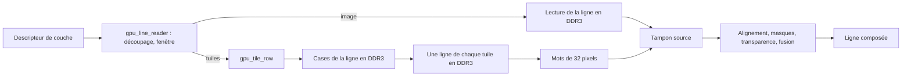

# L11 — décors en tuiles matériels

Extension de [G3](GPU_G3_REGISTRES.md) et [G4](GPU_G4_REGISTRES.md), même
bloc AHB à `0xe9000000`. Le cœur reste à 800 MHz, le bus AHB à 80 MHz, la DDR
UI à 75 MHz et le LCD à 35 MHz. G1 à G6 restent disponibles et inchangés.
Lot L11 de la [feuille de route](FEUILLE_DE_ROUTE_CONSOLE.md).
Validation : [TESTS_GPU_L11.md](../TESTS/TESTS_GPU_L11.md).
**Validé sur Pro Dock et visuellement**, build `gpu_l11_usb_r13` : défilement
à environ 55 images/s, USB corrigé (1 088 200 octets exacts), cœur 800 MHz.
Bitstream : `bitstreams/console_gpu_l11_800.fs`.

## Ce que c'est

Une **tuile** est une petite image carrée de 8, 16 ou 32 pixels de côté. Un
**décor en tuiles** est une grille qui indique quelle tuile afficher dans
chaque case. Un niveau de jeu de plusieurs écrans ne stocke que sa grille et
un jeu de tuiles, et une tuile sert autant de fois que nécessaire.

Chacune des 16 couches peut être soit une image, comme avant, soit un décor
en tuiles. Le GPU compose le décor **pendant l'affichage** : faire défiler un
décor, c'est changer deux nombres dans le descripteur de la couche. Aucune
commande de dessin n'est émise et aucune page n'est redessinée.

## Capacités

| Fonction | Valeur |
|---|---|
| Couches en tuiles | Chacune des 16 couches, librement mélangées aux images |
| Taille de tuile | 8 × 8, 16 × 16 ou 32 × 32, par couche |
| Surface affichée | Plein écran 800 × 480, fenêtre et position libres |
| Défilement | Au pixel, horizontal et vertical |
| Nombre de tuiles différentes | 8 192 par jeu de tuiles |
| Taille de la grille | 16 à 4 096 cases de large, 1 à 4 096 de haut, puissances de deux |
| Étendue du décor | Jusqu'à 32 768 pixels par axe |
| Retournement | Horizontal et vertical, par case |
| Répétition | Par axe : le décor se répète sans fin, ou s'arrête à son bord |
| Transparence | Index zéro, par couche, comme les images |
| Sprites | Inchangés : 64 sprites devant ou derrière chaque couche |

Il n'y a pas de rotation, de zoom ni de mélange alpha des tuiles à ce jalon.
Le bit 13 d'une case est réservé et s'écrit à zéro.

## Format en mémoire

Grille et jeu de tuiles sont en DDR3, écrits par le CPU ou chargés comme
ressources. Les deux adresses sont **alignées sur 32 octets**.

**Grille** : cases de 16 bits, petit-boutiste, ligne par ligne.
Case `(colonne, ligne)` à `grille + (ligne × largeur + colonne) × 2`.

| Bits | Contenu |
|---|---|
| 12:0 | Numéro de tuile, 0 à 8 191 |
| 13 | Réservé, écrire zéro |
| 14 | Retournement horizontal |
| 15 | Retournement vertical |

**Jeu de tuiles** : la tuile `n` de taille `T` occupe `T × T` octets à
`jeu + n × T × T`, ligne par ligne, un octet d'index de palette par pixel.
Un jeu de tuiles est propre à une taille.

## Descripteur d'une couche en tuiles

Mêmes huit mots et même table `0x800..0x9ff` qu'une couche d'image. Le bit 2
du mot 6 sélectionne le décor en tuiles ; les mots 1 et 5 changent de sens.

| Mot | Bits | Contenu |
|---|---|---|
| 0 | 31:0 | Adresse de la grille |
| 1 | 31:0 | Adresse du jeu de tuiles |
| 2 | 31:16 / 15:0 | Position Y / X signée de la fenêtre à l'écran |
| 3 | 31:16 / 15:0 | Hauteur / largeur de la fenêtre, jusqu'à 32 768 |
| 4 | 31:16 / 15:0 | Défilement Y / X, en pixels du décor |
| 5 | 3:0 / 7:4 / 9:8 | log2 largeur de grille / log2 hauteur / taille : 0 = 8, 1 = 16, 2 = 32 |
| 6 | 0 / 1 / 2 / 3 / 4 | Activation / transparence zéro / **tuiles** / répétition X / répétition Y |
| 7 | — | Réservé, écrire zéro |

Sans répétition, le décor se comporte comme une image de
`largeur × T` par `hauteur × T` pixels : rien n'est affiché au-delà de son
bord. Avec répétition, le défilement est pris modulo l'étendue du décor.

Le commit, la banque inactive et l'application au retour vertical sont ceux
de G3 et G4. La palette reste globale et hors de cette transaction.

## Couche refusée

Une couche en tuiles activée est refusée, **comptée** dans `0x038` à chaque
ligne et non affichée, dans les cas suivants :

- code de taille 3 ;
- largeur de grille inférieure à 16 cases ;
- étendue supérieure à 32 768 pixels sur un axe ;
- adresse de grille ou de jeu de tuiles non alignée sur 32 octets ;
- grille, ou 8 192 tuiles à partir du jeu, dépassant le premier Gio de DDR3.

Le dernier contrôle porte sur toute la plage atteignable : aucune case ne
peut faire lire le GPU hors de la mémoire, quel que soit son contenu.

## Registres ajoutés

| Offset | Accès | Contenu |
|---|---|---|
| `0x02c` | W | Toute écriture remet à zéro les maxima `0x02c`, `0x04c`, `0x050`, `0x054` |
| `0x05c` | R | Capacité : `0x00000d07`, index de tuile sur 13 bits, tailles 8, 16 et 32 |

Avant L11, les maxima ne repartaient de zéro qu'au reset du GPU. La remise à
zéro permet de mesurer la charge d'une scène donnée. La lecture de `0x02c`
est inchangée.

## API C

Dans [gpu.h](../fw_console/gpu.h) :

```c
int gpu_tiles_supported(void);
gpu_layer gpu_make_tile_layer(unsigned long map, unsigned long atlas, unsigned tile_size,
    unsigned map_w_log2, unsigned map_h_log2, int x, int y,
    unsigned view_width, unsigned view_height,
    unsigned scroll_x, unsigned scroll_y, unsigned flags);
```

Le descripteur rendu se place dans la table des 16 couches, soumise par
`gpu_layers_submit` ou `gpu_scene_submit`. Publier la grille et les tuiles
écrites par le CPU avec `gpu_publish_surface` avant le commit.

Pour modifier une case d'un décor affiché, écrire la case puis publier ses
deux octets. L'écriture n'est pas synchronisée avec l'affichage : une case
changée pendant la lecture de sa ligne peut apparaître une image plus tard.
Pour un changement d'ensemble sans image intermédiaire, préparer une autre
grille et changer son adresse au commit.

## Architecture



[gpu_tile_row.v](../tang/rtl/video/gpu_tile_row.v) fabrique la ligne du décor
sous la même forme qu'une ligne d'image lue en DDR3 : des mots de 32 pixels.
Tout ce qui suit dans
[gpu_line_reader.v](../tang/rtl/video/gpu_line_reader.v) est commun aux
images et aux tuiles : alignement, masques de bord, transparence, fusion,
sprites, priorités.

Pour une ligne, le module :

1. lit les cases de la ligne, 16 cases par lecture DDR3 ;
2. calcule pour chaque case l'adresse de la ligne de tuile à afficher ;
3. lit une ligne de tuile par lecture DDR3, jusqu'à 16 lectures en vol ;
4. extrait les octets, les retourne si demandé et les range dans le mot.

Les alignements sur 32 octets garantissent qu'une ligne de tuile tient dans
une seule lecture et qu'une lecture de cases ne change pas de ligne.

Une couche d'image suit exactement le même chemin et le même nombre de
cycles qu'avant L11 : le détour par les tuiles n'est pris que si le bit 2
du mot 6 est à un.

## Budget de ligne

Une ligne dispose d'environ 2 556 cycles à 75 MHz. Mesures de simulation en
800 × 480, couches plein écran, avec contre-pression DDR et lectures CPU
concurrentes du banc :

| Scène | Cycles par ligne |
|---|---:|
| Aucune couche active, 16 descripteurs parcourus | 259 |
| Une couche d'image | environ 130 de plus |
| Une couche de tuiles 32 × 32 | environ 175 de plus |
| Une couche de tuiles 16 × 16 | environ 255 de plus |
| Une couche de tuiles 8 × 8 | environ 395 de plus |
| 4 couches de tuiles 32 × 32 | 960 |
| 4 couches de tuiles 16 × 16 | 1 271 |
| 4 couches de tuiles 8 × 8 | 1 842 |
| 8 couches de tuiles 16 × 16 | 2 270 |
| 4 couches de tuiles (16, 16, 8, 32), 7 images et 64 sprites | 2 452 |
| 6 couches de tuiles 8 × 8 | dépassement, lignes manquantes comptées |

Une couche de tuiles 16 × 16 coûte environ deux couches d'image. Ces
chiffres viennent du banc de simulation. Sur la carte, les scènes de 16
images ont mesuré 2 435 à 2 477 cycles pour 2 341 en simulation : la charge
réelle se lit dans `0x02c`, et un dépassement est compté dans `0x01c`.
Réduire la fenêtre d'une couche réduit son coût.

## Implantation et timing

Le domaine graphique à 75 MHz était déjà proche de sa limite : le build
validé `gpu_fast_r2` avait une marge de +0,139 ns. L'ajout des tuiles
(3 002 cellules logiques) déplaçait les mémoires du GPU et du pont DDR3
d'un bout à l'autre du FPGA, et un chemin ancien différent passait en
défaut à chaque build. Les mesures prises, sans modifier ni les fréquences
ni les contraintes d'horloge :

| Mesure | Effet |
|---|---|
| Mémoires BSRAM du build validé ancrées dans `gpu.cst` ; quatre banques de descripteurs de sprites ensuite libérées | Le placement garde ses repères tout en rapprochant les descripteurs du lecteur |
| Étapes d'une couche de tuiles dans un registre séparé de l'état du lecteur | Les états existants gardent leur décodage sur quatre bits |
| Rejet d'une couche ou d'un sprite préparé un état plus tôt | Même décision au même cycle, sans comparaison devant le registre d'état |
| Demande de lecture des tuiles dans son propre registre, réunie par un OU | Aucun niveau logique ajouté devant l'arbitrage DDR3 |
| Prochaine demande et données reçues mises en registre dans `gpu_tile_row` | L'acquittement tardif de la DDR3 ne fait que valider des registres |
| État « file pleine » du pont DDR3 par sélection tardive | Même valeur, prouvée sur les 4 096 cas |
| Nom de cellule attribué par la synthèse résolu par `tools/build_gpu.py` | La contrainte de placement du pont ne dépend plus de la numérotation |

Les premières réécritures L11 sont vérifiées par les preuves
`TESTS/rtl/gpu_clip_equiv.sv` et `TESTS/rtl/ddr_tag_queue_equiv.sv`, avec
journaux de simulation identiques au cycle près. La correction USB et la
fermeture du timing ont ensuite simplifié le blitter, le diviseur, le
multiplexage AHB et l'arbitrage DDR ; leurs comparateurs sont décrits dans
[la fiche USB](../TESTS/TESTS_USB_REPRISE.md).

Seul l'acquittement de fin d'écriture DMA arrive volontairement un cycle
plus tard. Les pixels et les écritures restent exacts ; le banc de 541
commandes prend 1,73 % de cycles supplémentaires. La course conserve
55,11 images/s sur carte dans les deux modes de rendu. Les tuiles sont
composées pendant l'affichage et ne passent pas par cette voie d'écriture.

Une mémoire renommée ou supprimée par une évolution future arrête le build
sur sa ligne de `gpu.cst` : mettre à jour ou retirer cette ligne.

## Solutions écartées

| Solution | Raison |
|---|---|
| Dessiner les tuiles dans une page avec le blitter | Fenêtre limitée à 784 × 464 en tuiles 16 × 16, environ 7 ms de dessin simulés à chaque changement de tuile, pas de retournement |
| Redessiner l'écran à chaque image | 12,81 ms simulés en tuiles 16 × 16, 20,81 ms en 8 × 8, pour une image de 18,17 ms (`TESTS/study_tile_blit_cost.py`) |
| Tuiles gardées en BSRAM, comme les sprites | Environ 35 BSRAM pour 256 tuiles 16 × 16 seulement ; la lecture en DDR3 en donne 8 192 |
