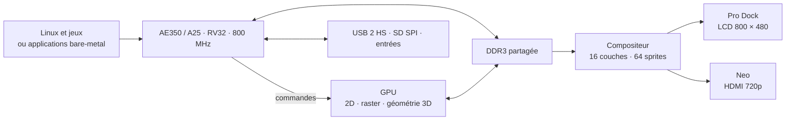

# Console FPGA · Pro Dock & Neo

**Un GPU matériel, Linux sur RISC-V, des jeux rendus en temps réel.**

Ce projet construit une console de jeux autour du Gowin **GW5AST-138** et de
son processeur **AE350/A25 à 800 MHz** : composition de couches, sprites,
tuiles, accélération 2D, triangles texturés et géométrie 3D matérielle.
Linux permet de lancer les jeux comme des exécutables et de conserver un
terminal et un tableau de diagnostic à l'écran.

| Plateforme | Affichage | État au 31 octobre 2026 |
|---|---|---|
| **Tang Mega Pro Dock 138K** | LCD **800 × 480** | Référence fonctionnelle **G22r0 / NEBULA R17**, conservée avec ses limites historiques |
| **Tang Neo / Console 138K** | HDMI **1280 × 720** | Portage en diagnostic ; mire observée, GPU complet non validé |

> Un résultat appartient à un **bitstream, un logiciel et une carte précis**.
> Une simulation ou un timing positif ne remplace pas un essai matériel.
> La référence G22r0 conserve notamment neuf violations setup, dont −0,564 ns,
> et des duplications CDC occasionnelles documentées.

[Description du projet](ARCHI/PROJET.md) ·
[Construire et tester](ARCHI/DEMARRAGE_ET_TESTS.md) ·
[Compatibilité des cartes](ARCHI/COMPATIBILITE_CARTES.md) ·
[Organisation et nettoyage](ARCHI/CLEANUP.md)

## Architecture



Le CPU gère le jeu, les collisions, la caméra et les matrices des objets.
Le FPGA transforme les maillages, projette et dessine les triangles, puis
compose l'affichage. Les images sont **calculées en direct**, sans lecture
d'un film. Les textures, les maillages et certaines animations sont préparés
en amont ; cela ne remplace pas le rendu sur la carte.

Les sources communes restent uniques. Les différences de brochage,
d'horloges, de mémoire et d'intégration sont définies par les profils de
carte et leur [inventaire](tang/boards/ownership.json).

## Capacités graphiques

| Bloc | Fonctions |
|---|---|
| **Composition** | Fond RGB565, 16 couches indexées ou tuilées, fenêtres, priorités et défilement au pixel |
| **Sprites 2D** | 64 sprites matériels, jusqu'à 32 × 32 pixels, retournements et transparence par index zéro |
| **Décors / texte** | Tuiles 8, 16 ou 32 pixels ; terminal Linux utilisant les glyphes matériels |
| **Dessin 2D** | Primitives, copies, texte, zoom et transformations affines dans les surfaces de dessin |
| **Raster** | Triangles RGB565, textures corrigées en perspective, Z-buffer 16 bits, scissor |
| **Effets** | Alpha ARGB4444, mélange additif, modulation, brouillard et mipmaps préparées à l'avance |
| **Géométrie G3D1** | Lecture des maillages DDR, matrices, clipping, projection, élimination des faces arrière, éclairage directionnel |
| **Présentation** | Double tampon et application atomique des descripteurs au retour vertical |

Les « sprites 3D » sont des quadrilatères texturés utilisant G3D1, distincts
des 64 sprites du compositeur. La rotation affine dessine dans une surface :
elle ne fait pas tourner directement les sprites du compositeur.

L'alpha appartient au moteur de dessin RGB565 ; les couches indexées
utilisent une clé de transparence. Les capacités des tables ne garantissent
pas que 16 couches plein écran tiennent simultanément dans le budget DDR.
Il n'y a pas de shaders programmables ni de filtrage bilinéaire.

Voir les contrats [GPU V1](ARCHI/GPU_V1.md),
[géométrie G3D1](ARCHI/GPU_GEOMETRY.md) et
[composition](ARCHI/GPU_PERSPECTIVE_COMPOSITION.md).

## Linux et affichage partagé

```text
                  Pro Dock · 800 × 480
┌──────────────────────────┬──────────────────────────┐
│ Jeu graphique 400 × 240   │ Terminal Linux           │
├──────────────────────────┴──────────────────────────┤
│ Diagnostic GPU / USB / SD : tableaux et compteurs   │
└─────────────────────────────────────────────────────┘
```

Le jeu ou le terminal peut occuper tout l'écran. Les couches 12–15 et une
partie de la palette restent réservées aux consoles Linux. Un pilote unique
sérialise les commandes GPU et protège les ressources d'affichage.

Sur une Pro Dock déjà démarrée avec le paquet logiciel adapté :

```sh
prodockctl layout split
prodockctl layout game
prodockctl layout console
nebula --demo
```

Le chargement initial FPGA, le chargement CPU/JTAG et la console SOFT-USB
sont des opérations distinctes. Voir le
[guide Linux](linux/README.md) et le
[contrat d'affichage partagé](ARCHI/LINUX_AFFICHAGE_PARTAGE.md).

## Jeux et démonstrations

| Projet | Expérience | Documentation |
|---|---|---|
| **LUMA** | Aventure automatique en forêt, héros animé, portail, cristal et final lumineux | [LUMA](assets/luma/README.md) |
| **ORBITAL** | Démonstration de tir à la première personne, drones, textures et effets | [ORBITAL](assets/orbital/README.md) |
| **ASTRILLA** | Voyage spatial, vaisseaux 3D, trous noirs, combat et atterrissage | [ASTRILLA](ARCHI/ASTRILLA.md) |
| **NEBULA** | Jeu spatial sous Linux, trois secteurs, tirs, explosions et boss | [NEBULA](linux/NEBULA.md) |
| **LUMA3D** | Exploration 3D, régions et activités : puzzles, jeux de plateau, Simon, shooter… | [Moteur et jeu](games/luma3d/README.md) |

LUMA3D vise un monde riche et une campagne longue. Le contenu actuel et les
candidats en préparation ne constituent pas encore plusieurs heures de jeu
qualifiées. Les ressources visuelles sont travaillées avec ComfyUI, puis
converties vers les formats supportés par le GPU.

## Avancement vérifié

| Sujet | Résultat et limite |
|---|---|
| **Pro Dock de référence** | G22r0 / NEBULA R17 restaurée et testée ; référence protégée, distincte des nouveaux candidats |
| **Seconde Pro Dock / SD** | Démarrage U-Boot puis Linux depuis la SD observé avec le FPGA chargé en SRAM ; autonomie après coupure non qualifiée |
| **Débit SD** | Problème ouvert : 27 lectures CRC/volume correctes ; 64 Kio autour de 1,47 s sans chronométrage détaillé, avec un noyau de diagnostic plus lent que l'ancien |
| **Jeux de plateau** | A/B/A : Solitaire 5,85 → 20,91 → 5,91 FPS ; Chroma 5,81 → 17,50 → 5,68 ; Othello 4,95 → 11,10 → 4,98 ; Pendu 5,12 → 12,09 → 4,92 |
| **Fluidité restante** | Ces gains concernent quatre activités ; des images prennent encore 217–275 ms. Ils ne prouvent pas un gain sur l'exploration 3D |
| **Parcours 3D** | Dernier A/B/A à pose fixe : 6,86 → 6,73 → 6,69 FPS, aucun gain démontré ; 475 commandes et huit lots par image |
| **Nouveau monde Serres** | Candidat compilé et testé localement ; 26 étapes automatiques, environ 15 min simulées ; essai matériel encore à faire |
| **Neo** | R19 accepte TARGET et SCISSOR, rejette COPY même injectée par AHB avec CPU volontairement arrêté ; cause encore inconnue |

Les mesures ci-dessus sont datées du **31 octobre 2026**. Les résultats et
leurs limites sont détaillés dans [PROJET.md](ARCHI/PROJET.md).
La démo ORBITAL R6 atteignait **54,81 images/s** sur C37 lors de sa campagne
historique ; ce chiffre ne décrit pas les performances de LUMA3D.
Le diagnostic [SD / SPI High Speed](ARCHI/SD_SPI_HIGH_SPEED.md) distingue
le mode de la carte, les plafonds du pilote et l'horloge effectivement produite.

## Construire et vérifier

Depuis la racine du dépôt, avec les prérequis du
[guide de construction](ARCHI/DEMARRAGE_ET_TESTS.md) :

```sh
# Tests du jeu sur le poste ; aucun chargement de carte.
make -C games/luma3d test

# Rapport local dans un nouveau dossier.
python3 tools/run_board_regressions.py --out TESTS/dual_board/ma_verification_01

# Construction Linux candidate, après validation des entrées.
make -C linux BOARD=prodock BUILD_ARGS=--candidate all JOBS=4
```

La console complète utilise **Gowin** pour la synthèse et le routage.
Le [Workbench](optimizer/README.md) ajoute analyse, recherche de placement
et essais Yosys/nextpnr/Apicula sur des sous-ensembles ; la chaîne libre ne
remplace pas actuellement Gowin pour la console complète.

## Organisation du dépôt

| Répertoire | Rôle |
|---|---|
| [`tang/`](tang) | RTL, IP fournisseur, contraintes et profils des cartes |
| [`fw_console/`](fw_console) | Applications bare-metal et API GPU |
| [`linux/`](linux) | Noyau, pilotes, OpenSBI, U-Boot et applications Linux |
| [`games/`](games) / [`assets/`](assets) | Jeux et ressources graphiques |
| [`tools/`](tools) / [`optimizer/`](optimizer) | Construction, analyse, chargement et diagnostics |
| [`ARCHI/`](ARCHI) | Architecture, interfaces et procédures |
| [`TESTS/`](TESTS) | Fiches, bancs et preuves ; certains artefacts restent locaux |
| [`bitstreams/`](bitstreams) | Fiches et empreintes des versions conservées ; archives locales protégées |

Les règles de contribution sont dans [AGENTS.md](AGENTS.md) : diagnostic
avant correction, un propriétaire par ressource matérielle, modules commentés
d'au plus 1 000 lignes pour le code maîtrisé, tests traçables et préservation
des références. Un dossier ignoré par Git n'est jamais, à lui seul, une
autorisation de suppression.
