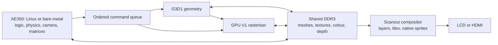

# Console architecture

This project combines the Gowin GW5AST-138's AE350/A25 RISC-V processor with a
custom fixed-function graphics pipeline. The supported design profiles are the
Sipeed Tang Mega Pro Dock LCD and the Tang Neo console HDMI target. The Pro Dock
has functioning applications; the Neo port remains under investigation. Shared
RTL and software do not make their hardware qualification interchangeable.

The arrows describe responsibilities, not independent unarbitrated DDR ports.
The implemented memory arbiters serialize and track the participating clients.
CPU and video share DDR3; the framebuffer is not a separate external SRAM.

## Division of work

| Component | Responsibility |
|---|---|
| CPU | Input, game rules, AI, collisions, simulation, camera, object matrices, resource preparation and command submission. |
| G3D1 geometry | Read indexed meshes; apply an affine 3×4 matrix; clip against six camera planes; project; cull back faces; calculate flat directional lighting and interpolation planes. |
| GPU V1 raster | Triangle coverage, texture reads, perspective correction, Z16 testing/writes, tint, alpha, additive blending, Gouraud gains and fog into RGB565 targets. |
| Legacy 2D engines | Fills, lines, text, copies, indexed primitives and affine drawing. |
| Compositor | Combine the base framebuffer with indexed surfaces, tilemaps and native 2D sprites. |
| Display interface | Pixel timing and electrical output for the board's LCD or HDMI. |

This is real-time rendering, not video decoding. A G3D1 DRAW references a mesh;
the CPU need not transform each vertex. The CPU still computes application
state and matrices. Older V1-only applications may perform geometry work on the
CPU before submitting triangles. Offline textures, meshes and cinematic view
caches remain legitimate resources and are identified in the individual demos.

## Graphics capabilities and limits

- **Geometry:** up to 256 vertices and 65,535 faces per mesh DRAW, 32-byte vertex
  and face records, fixed-point coordinates and explicit camera/light state.
  G3D1 uses flat directional lighting; the raster Gouraud flag is not supported
  by that geometry ABI. Instancing reuses mesh data with different matrices.
- **Raster:** RGB565 colour and Z16 depth targets; scissor and partial clear;
  RGB565/ARGB4444 textures; perspective-correct nearest-neighbour sampling;
  explicit mip level; colour modulation, alpha/additive blending and linear fog.
  Maximum V1 target dimensions are 1024×512 and textures are at most 512×512.
- **Texture cache:** the current G3D1 implementation has **32 KiB**, comprising
  1,024 native 32-byte DDR lines. The older GPU V1 document's 2 KiB/64-line
  description belongs to an earlier implementation. See the current
  [cache RTL](../tang/rtl/video/gpu_texture_cache.v).
- **Composition:** 16 layer descriptors and 64 native 2D sprite descriptors.
  Native sprites are 1–32 pixels per axis with flips and priority. Tilemaps
  and surface layers support scrolling and clipping.
- **3D billboards:** textured quad meshes through G3D1, distinct from the
  64 native sprite slots. Their count is constrained by rendering work.

The compositor uses indexed/key transparency. It does **not** alpha-blend
16 full-screen layers. Per-texel ARGB4444 alpha, global alpha and additive
effects happen in the rasteriser while drawing the RGB565 target. Sixteen
layers and 64 sprites are table capacities: legal descriptors can still exceed
the memory work available for a scanline. Underflow and workload counters
must be checked for the actual scene.

There are no programmable shaders, OpenGL/Mesa compatibility, bilinear texture
filtering or automatic derivative-based mip selection. These limits do not
prevent hardware-accelerated 2D and 3D games, but they affect content design.

## Memory ownership and frame completion

Commands contain eight 32-bit words and use one ordered producer. Rendering,
scanout and CPU accesses meet through the memory architecture; applications
must retain resource ownership until the corresponding operation completes.

V1 addresses are byte addresses; bases and pitches require 32-byte alignment.
Colour/depth allocations must be disjoint, and texture/target aliasing is
restricted. The Linux memory window is narrower than the raw hardware ABI;
applications must use the driver-reported limits rather than arbitrary DDR.

Three separate events matter:

1. **CPU publication:** CPU-written resource bytes must reach memory before
   the GPU reads them. Linux performs the required platform cache service in
   its submission/presentation paths. Bare-metal callers use the explicit
   publication/cache-maintenance APIs.
2. **GPU texture invalidation:** after changing texture bytes, enqueue an
   ordered INVALIDATE before sampling them. Binding a texture descriptor alone
   does not invalidate cached texels.
3. **Completion/presentation:** wait for drawing before reading or reusing its
   resources, and wait for display ownership to change before overwriting the
   displayed buffer. Command completion and a vertical-blank swap are distinct.

Linux `PRODOCK_SUBMIT` is synchronous; bare-metal `gpu_submit` only queues a
command. Similarly, some bare-metal scene helpers request a swap without
waiting, whereas Linux presentation waits for it. See the
[API reference](API_REFERENCE.md) for the exact contracts. Cache maintenance
is explicit; mapping memory with `pgprot_noncached()` alone does not establish
coherence on this port.

## Linux, firmware and platform profiles

Linux and bare-metal applications are separate boot modes. Linux provides
the GPU ioctl/mmap interface, a text terminal, the shared-screen dashboard,
storage and normal process services. The accelerator has a single trusted
owner; it is not an isolated multi-process desktop GPU. Bare-metal demos use
the related command builders without a kernel.

The Pro Dock game profile normally renders 400×240 RGB565 and scales it ×2
to the 800×480 LCD; indexed overlays can remain at native resolution. The
Neo target uses 1280×720 HDMI, with a 640×360 game profile. Host tests of both
profiles do not establish physical Neo framebuffer or timing correctness.

The historical Pro Dock design configures an 800 MHz CPU, 80 MHz bus,
75 MHz GPU/DDR user interface and 35 MHz LCD clock. These are design settings,
not independently measured clock-frequency results for every peripheral.
SD uses the native AE350 SPI adapter in the current Linux implementation;
USB device/host and board pin/clock/reset integration have their own contracts.

Normal operation is intended to use SD boot and SOFT-USB. J-Link is a
diagnostic tool used only with explicit agreement, not the routine installation
path. A successful diagnostic RAM boot does not qualify autonomous boot or a
complete USB software-installation workflow.

## What MAZE uses and what remains separate

| Feature | Current game use |
|---|---|
| G3D1 mesh geometry and V1 depth/texturing | World scenery, characters and the 3D house maze. |
| Native indexed composition | HUD and interface surfaces; not 16 layers in every frame. |
| CPU-generated/published surfaces | Some table-game UI and textures; hardware acceleration does not remove all CPU pixel work. |
| Native 2D sprites and tilemaps | Available and used by other demonstrations; not the principal world-character path. |
| Alpha, additive effects and mipmaps | Available; use depends on the scene/material. Availability is not evidence that every game uses them. |

The [current restoration](../TESTS/prodock_game_restore_20261103/TEST_RECORD.md)
is a Pro Dock R6/MAZE observation, not a new timing-closure or Neo qualification.
The preserved G22r0 reference also retains its documented negative timing
margin. Simulations, host tests, synthesis, timing analysis, pixel comparisons,
endurance and visual checks are separate evidence categories.

Further detail: [G3D1](../ARCHI/GPU_GEOMETRY.md),
[V1 command ABI](../ARCHI/GPU_V1.md),
[board compatibility](../ARCHI/COMPATIBILITE_CARTES.md),
[games](GAMES.md) and [software development](SOFTWARE_DEVELOPMENT.md).
